# SunBro's Edition: Bloodborne PC Launcher

   

<table>
<tr>
<td width="200" valign="middle">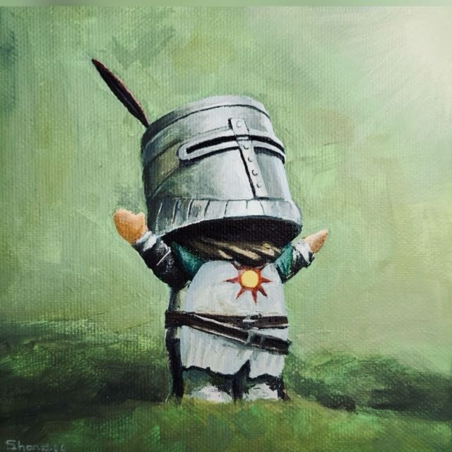</td>
<td valign="middle">Custom Windows build based on Jgamrot's Bloodborne PC port 2.1 and BBSC 0.0.2, with a Qt Quick launcher, DLSS (and DLSS 5 neural rendering through the community route), FSR 3.1 / 4.1.1, frame generation, HDR10, spatial sound and Vulkan ray tracing.</td>
</tr>
</table>

**v4.4.1:** Maintenance on top of 4.4.0, which made Play start the game in seconds. The launcher no longer shows old copies from save backup folders as your characters. [Changelog](docs/changelog/changelog-2026-11-06-4.4.1.md)

*The 4.4.1 launcher: Home, Visuals, Ray tracing, Online, Co-op, Dossier, Workshop, Settings and the what's-new sheet. [Watch the video (MP4, 3840 × 2160, 30 FPS)](docs/media/launcher-4.4.1-tour.mp4). Rendered from the live launcher at 4K with an example hunter; page changes are crossfaded in the video.*

## Highlights

- **DLSS 4.5, DLSS 5 and FSR 4.1.1:** model selection, frame generation, and DLSS 5 neural rendering through the community route with your own add-ons.
- **Spatial sound:** the game's real 7.1 mix reaches Dolby Atmos, Windows Sonic and DTS channel by channel, or a 5.1 / 7.1 output directly.
- **HDR10:** 10-bit BT.2020 / PQ output with paper white up to 800 nits, peak up to 4000 nits and highlight boost.
- **Ray tracing:** ambient occlusion and moon shadows, with quality presets.
- **NG+7 world:** one switch for full NG+7 enemies from the first beast and every Caryll Rune. Your save keeps its real cycle.
- **Hunter's Arsenal and lamps:** Sojin Chikage and Thunderwright's Kirkhammer, plus Level Up and Storage at every lamp.
- **Hunter's Atlas:** maps, your position on them and opt-in lamp travel.
- **Seamless co-op and The Hunter's Dream online:** private or public, with BBSC 0.0.2.
- **Save backups:** manual and automatic, with restore and rollback.

## Gameplay: DLSS 4.5 vs DLSS 5

*DLSS 4.5 (left) and DLSS 5 through the community route (right), filmed in separate runs with the same route, so the two sides drift slightly: the Thunderwright's Kirkhammer at Lumenwood Garden, Nightmare Church and the Cainhurst gate. 4.4.1 on an RTX 4090: DLSS Quality, model M, Ultra graphics and ray tracing, native HDR on, frame generation off, recorded at a 60 FPS cap. DLSS 4.5 is 4K output; DLSS 5 is 1440p output scaled to 4K, because it can't hold 60 FPS at 4K output even on this card. DLSS 5 adds surface depth and contrast, and shifts the game's look; DLSS 4.5 is sharper and closer to the original art. In play at the DLSS 4.5 settings: about 84 FPS with a 120 cap, or 120 shown from 60 with DLSS 2× frame generation. DLSS 5 is optional and off by default. [Watch the video (MP4, 3840 × 2160, 60 FPS, HDR10, 156 MB)](https://github.com/wanderabyss/sunbros-bloodborne-launcher/releases/download/v4.4.1/bloodborne-4.4.1-dlss45-vs-dlss5-4k-hdr.mp4), attached to the v4.4.1 release. The preview above is SDR.*

## Screenshots

*Rendered from the live 4.4.1 launcher at its opening size, 1477 × 950, with an example hunter.*

<table>
<tr>
<td width="50%" valign="top"><a href="docs/images/launcher-4.4.1-home.png">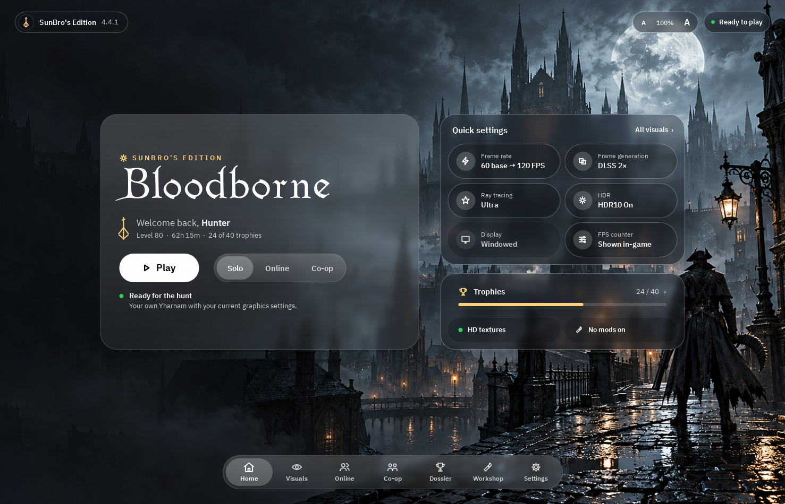</a> <b>Home</b>: Play, play modes, quick settings and your hunt.</td>
<td width="50%" valign="top"><a href="docs/images/launcher-4.4.1-visuals.png">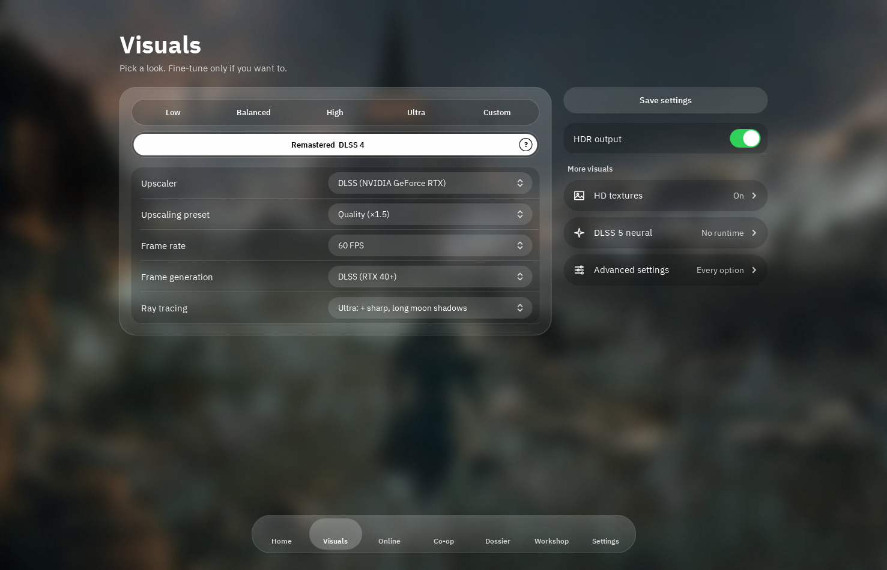</a> <b>Visuals</b>: Low to Ultra and Custom, then the presets tuned on an RTX 4090, each with a ? tip. Save settings, HDR and the shortcuts on the right.</td>
</tr>
<tr>
<td width="50%" valign="top"><a href="docs/images/launcher-4.4.1-visuals-advanced.png">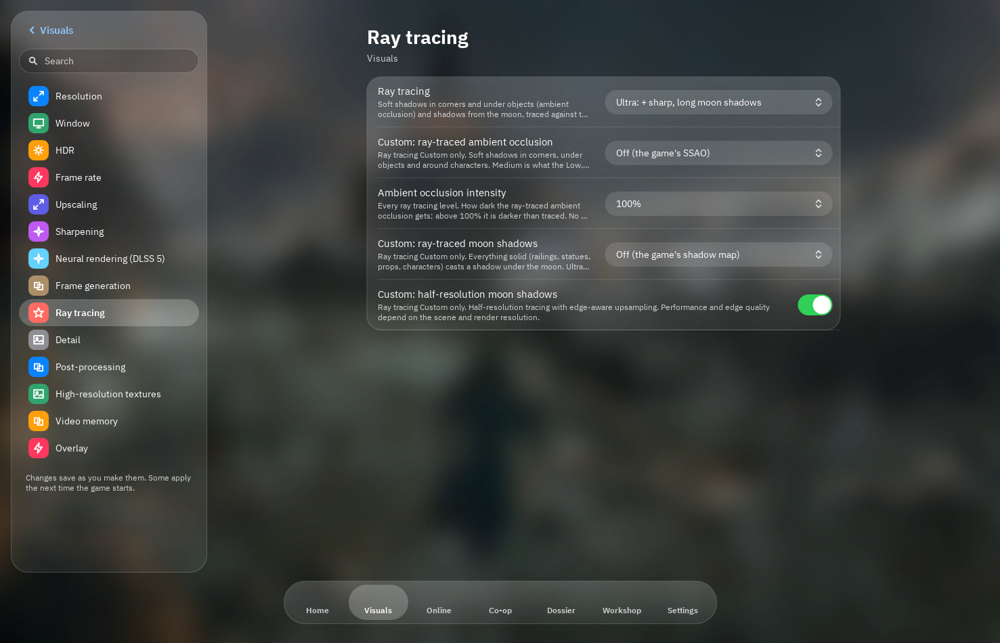</a> <b>Advanced settings</b>: One topic per section, with search. Ray tracing shown.</td>
<td width="50%" valign="top"><a href="docs/images/launcher-4.4.1-coop.png">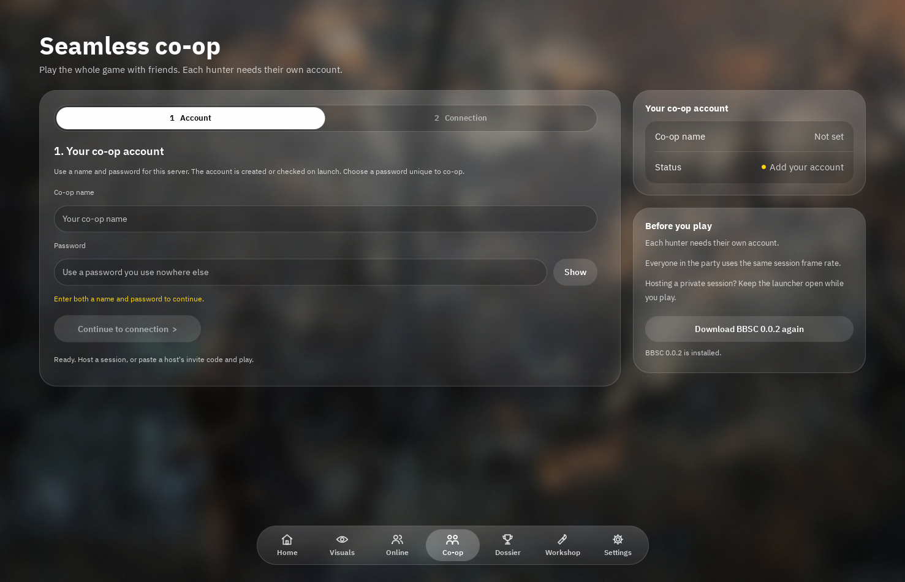</a> <b>Seamless co-op</b>: Account, then Connection: private (Tailscale) or the public server, host or join, and Play. Show connection details checks the ports.</td>
</tr>
<tr>
<td width="50%" valign="top"><a href="docs/images/launcher-4.4.1-dossier.png">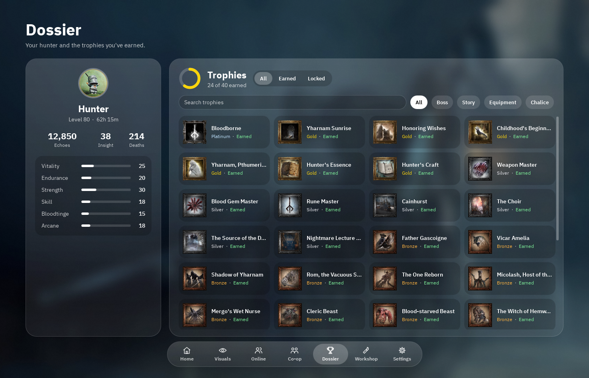</a> <b>Dossier</b>: Your hunter, attributes and every trophy, earned or locked.</td>
<td width="50%" valign="top"><a href="docs/images/launcher-4.4.1-workshop.png">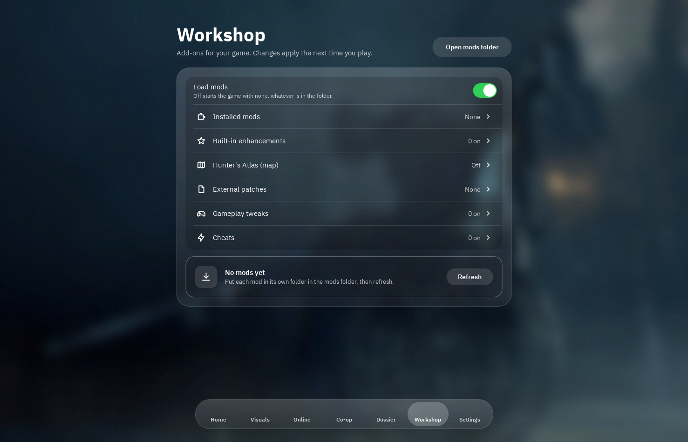</a> <b>Workshop</b>: Mods, built-in enhancements, Hunter's Atlas and patches at a glance.</td>
</tr>
<tr>
<td width="50%" valign="top"><a href="docs/images/launcher-4.4.1-online.png">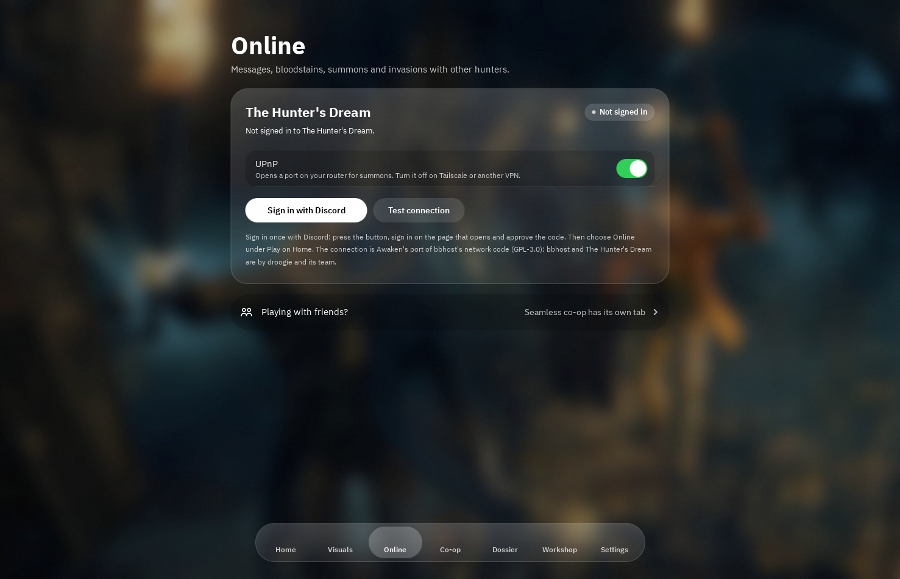</a> <b>Online</b>: The Hunter's Dream: messages, bloodstains, summons and invasions.</td>
<td width="50%" valign="top"><a href="docs/images/launcher-4.4.1-settings.png">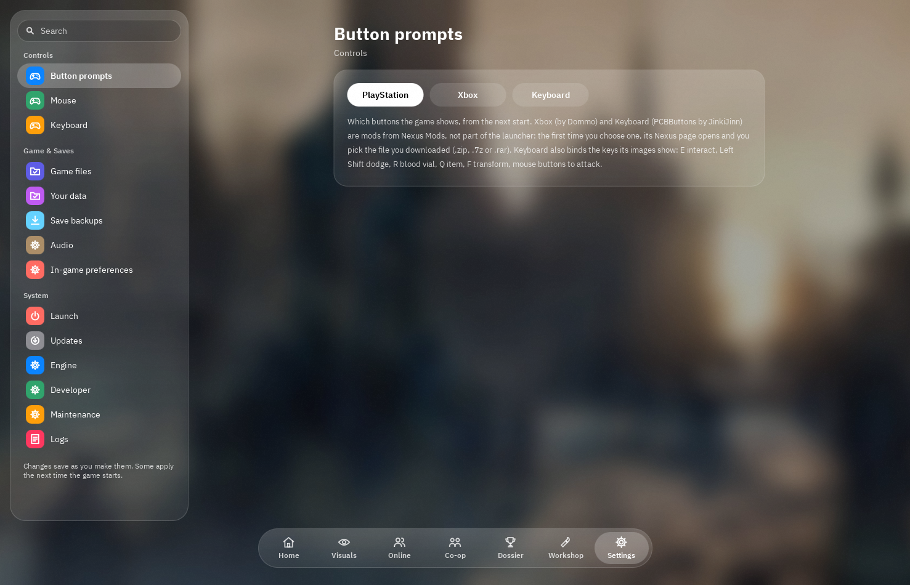</a> <b>Settings</b>: Controls, Game & Saves and System, with A− / A+ for the interface size.</td>
</tr>
<tr>
<td width="50%" valign="top"><a href="docs/images/launcher-4.4.1-whats-new.png">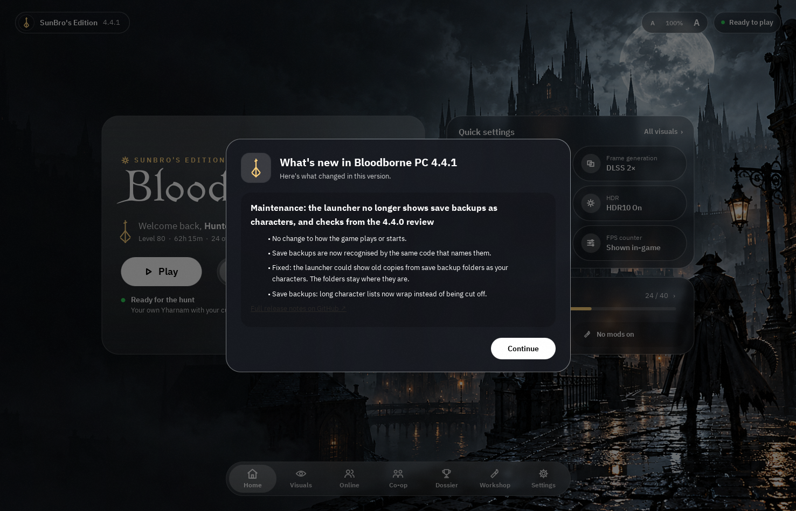</a> <b>What's new</b>: Updates and new versions show a short changelog.</td>
<td width="50%" valign="top"><a href="docs/images/launcher-4.4.1-setup.png">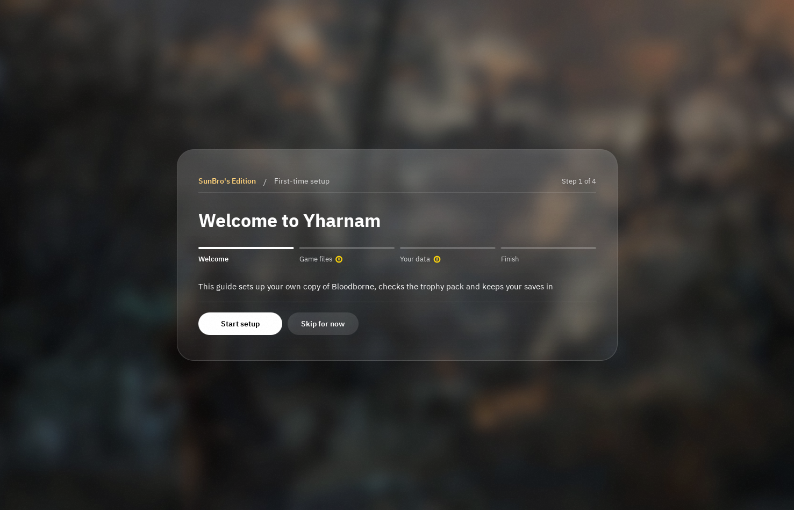</a> <b>First-time setup</b>: Game files and your data in four short steps.</td>
</tr>
</table>

## Features

| Feature | Current capability |
| --- | --- |
| Launcher | Frosted-glass Qt Quick UI over Bloodborne art: Home with quick settings, one tab bar, single-topic settings with search, Hunter profile and trophy archive. Sized to the screen and sharp at 4K (A− / A+), with update notes in the launcher. |
| Save backups | Back up now (with a label), automatic backup after each session (last 10 kept), restore with a safety backup and rollback, delete; all in Settings > Game & Saves. |
| Upscaling | DLSS model selection and Auto policy, DLSS mip bias −1 by default and live mip offset, FSR 3.1, FSR 4.1.1 on Windows through fsr4vk (experimental, one-click download; up to 1080p output on NVIDIA), FSR 1 EASU when the output is smaller than the display. |
| DLSS 5 | Neural rendering through the player's own ReShade + dlss5-bridge + renodx-dlss5 (nothing shipped); one switch, the add-on's look settings, runtime status and a DLSS 5 ready preset sized to the output (★ DLSS 5, next to Remastered's ★ DLSS 4); stays off and says why when ReShade won't load it. [Setup guide](docs/dlss5-setup.md). |
| Frame generation | DLSS-G through the NGX bridge (ABI 3: SR, FG and DLSS 5 entry points, the last unsupported until NVIDIA ships it); FSR fallback. HDR + DLSS 2× evaluation observed on RTX 4090. |
| HDR output | **BT.2020 / ST 2084 PQ, 10-bit RGB** swapchain; final conversion shared by rendered and generated frames. Paper white (to 800 nits), peak brightness (or the display's) and highlight boost settings. The picture is SDR expanded to HDR at the final step; physical display calibration remains pending. |
| Spatial sound | The game's 7.1 mix goes to Windows spatial audio objects when Dolby Atmos, Windows Sonic or DTS is on, and to a 5.1 / 7.1 output directly otherwise. Checked with Dolby Atmos for Headphones; other formats and speakers are not yet tested. A launcher toggle under Game & Saves, Audio turns it off. |
| Ray tracing | Ambient occlusion and moon shadows, quality presets, half-resolution shadows and custom reach. Reflections and secondary-light shadows remain unavailable. |
| Diagnostics | Runtime provider/fallback status, generation/presentation counters and Reflex marker intervals. A rejected memory free names its block in `last_run.log`. |
| Hunter's Atlas | Bundled maps/art, position overlay and opt-in lamp travel. |
| NG+7 hammer | Optional switch (`pc_ng7_hammer`): the Stormforged Kirkhammer from the Bath Messengers, in normal, Uncanny and Lost versions: Thunderwright's Kirkhammer with stronger stats and Arcane scaling. Brings Hunter's Arsenal with it. |
| NG+7 Sojin Chikage | Optional switch (`pc_ng7_chikage`): three Bloodsworn weapons from the Bath Messengers, the Sojin Chikage with stronger stats and Bloodtinge scaling. Brings Hunter's Arsenal with it. |
| NG+7 world | Optional switch (`pc_ng_plus_7`): full NG+7 enemies and echoes from the first beast, and every Caryll Rune once. The save keeps its real cycle, so switching it off puts the character back. |
| Multiplayer | Offline, The Hunter's Dream online and BBSC 0.0.2 seamless co-op; co-op caps game simulation at 60 FPS. |
| Builds | MSYS2 native renderer, VS 2026 DLSS bridge, frozen launcher and ZIP packaging. |

Detailed capabilities and limits: [Feature catalog](features.md). A target FPS setting is not a sustained-performance guarantee.

## Getting started

1. Extract the complete distribution and open **Bloodborne.exe**.
2. Select your own decrypted game dump and save location in the launcher; game assets are not included.
3. Choose a hunt mode and graphics settings, save them, then launch.

For HDR, enable Windows HDR on the selected display, then **Visuals → Display & frame rate → HDR output** (paper white, peak brightness and highlight boost are just below it). Frame generation is configured in **Visuals → Frame generation**.

## Documentation

| Guide | Contents |
| --- | --- |
| [Build and packaging](build.md) | Toolchains, native/launcher builds, tests, versions and distribution checks. |
| [Launcher guide](docs/changelog/README-LAUNCHER-V30.md) | Settings, configuration, co-op and runtime diagnostics. |
| [Release notes](Release_Notes.md) / [4.0.0 changelog](docs/changelog/changelog-2026-10-29-4.0.0.md) | Version history; 4.0.0's save backups, HDR levels, DLSS 5 neural rendering and FSR 4.1.1. |
| [DLSS 5 setup](docs/dlss5-setup.md) | The files DLSS 5 neural rendering needs (ReShade, dlss5-bridge, renodx-dlss5, `nvngx_dlssnr.dll`), where they go and how to check it works. |
| [DLSS 4.5 vs DLSS 5 at 4K](docs/dlss-4.2.0-comparison.md) | 4.2.0's measurements on an RTX 4090: every DLSS tier with and without frame generation, DLSS 5, frame times, power and screenshots, with the recommended settings. |

Source lives in `bloodborne_pc/` ([port README](bloodborne_pc/README.md), with every third-party package it uses). This is a custom build; see the upstream [port](https://github.com/Jgamrot/bloodborne_pc) and [BBSC](https://github.com/CLSAMG22/BBSC) projects for their work.

## License

GNU General Public License v3.0 or later: see [LICENSE](LICENSE). Third-party packages keep their own licences; see the [port README](bloodborne_pc/README.md#third-party-packages).
