# SunBro's Edition: Bloodborne PC Launcher

<table>
<tr>
<td width="200" valign="middle">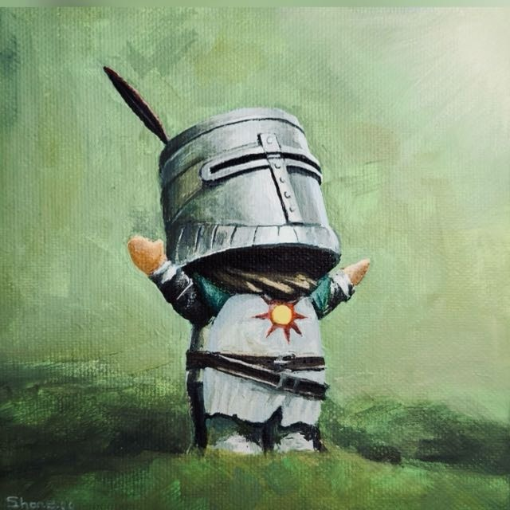</td>
<td valign="middle">Custom Windows build based on Jgamrot's Bloodborne PC port 2.1 and BBSC 0.0.2, with a Qt Quick launcher, DLSS (and DLSS 5 neural rendering through the community route), FSR 3.1 / 4.1.1, frame generation, HDR10 and Vulkan ray tracing.</td>
</tr>
</table>

**v4.2.9:** Updates come from the new repository, wanderabyss/sunbros_bblauncher; the licence files say GPL v3. [Changelog](docs/changelog/changelog-2026-10-30-4.2.9.md) · v4.2.8: The bells after seamless co-op are normal bells again offline and online. [Changelog](docs/changelog/changelog-2026-10-30-4.2.8.md) · v4.2.7: Save settings and a tidier Visuals page, a co-op connection check, Download BBSC back. [Changelog](docs/changelog/changelog-2026-10-30-4.2.7.md) · [All versions](docs/changelog/README.md) · [Release notes](Release_Notes.md) · [DLSS 4.5 vs DLSS 5 at 4K](docs/dlss-4.2.0-comparison.md)

<a href="docs/media/launcher-4.2.7-tour.mp4">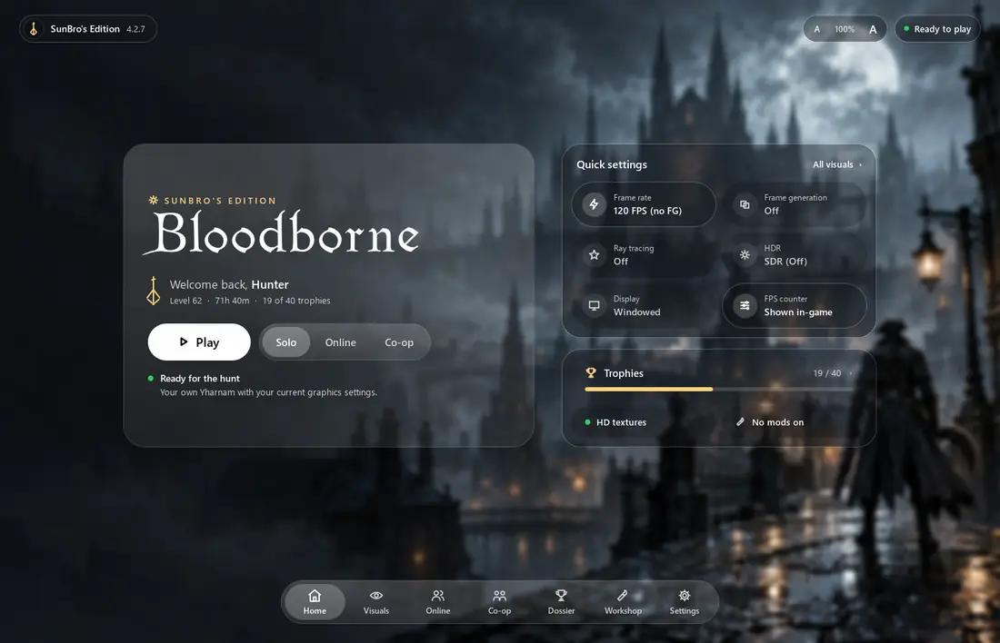</a>

*The 4.2.7 launcher: Home, then Visuals (Ultra, Remastered DLSS 4 and DLSS 5 with their ? tips, Save settings), Online, Co-op, Dossier, Workshop, Settings and the what's-new sheet. [Watch the video (MP4, 1460 × 940, 30 FPS)](docs/media/launcher-4.2.7-tour.mp4). Rendered from the live launcher with an example hunter; FPS values are configured targets.*

## Gameplay

<a href="https://github.com/wanderabyss/sunbros_bblauncher/releases/download/v4.2.9/bloodborne-4.2.4-dlss5-gameplay.mp4">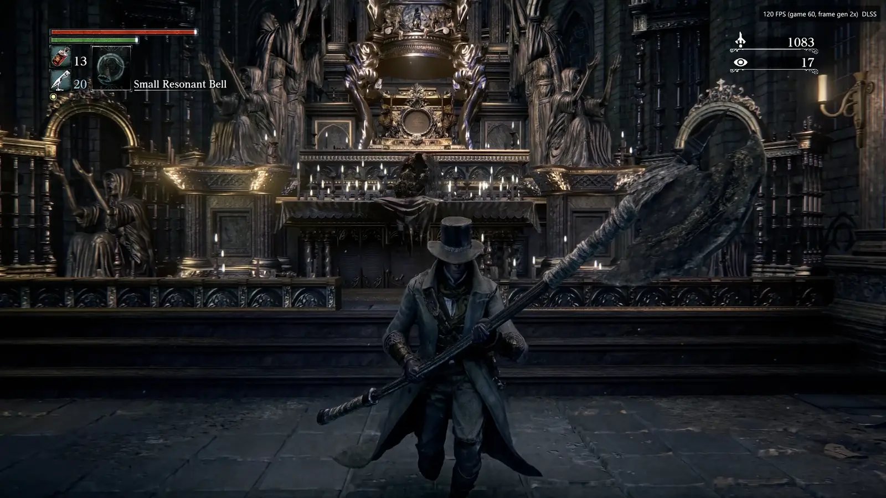</a>

*30 seconds of 4.2.4 with DLSS 5 neural rendering on an RTX 4090: the Grand Cathedral, the Witch of Hemwick's arena and Old Yharnam. 2560 × 1440 output scaled to a 4K display, DLSS Quality (model K), DLSS 2× frame generation at a 60 FPS base (120 shown), Reflex, ray tracing Ultra, NR style Cinematic with local structure 2.00. Recorded from the 4K desktop with HDR off. [Watch the video (MP4, 3840 × 2160, 60 FPS, 105 MB)](https://github.com/wanderabyss/sunbros_bblauncher/releases/download/v4.2.9/bloodborne-4.2.4-dlss5-gameplay.mp4), attached to the v4.2.9 release.*

## Screenshots

*Rendered from the live 4.2.7 launcher at 1460 × 940 with an example hunter.*

<table>
<tr>
<td width="50%" valign="top"> <b>Home</b>: Play, play modes, quick settings and your hunt.</td>
<td width="50%" valign="top"><a href="docs/images/launcher-4.2.7-visuals.png">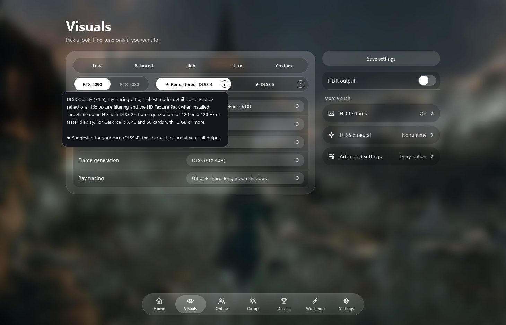</a> <b>Visuals</b>: Low to Ultra and Custom, then the presets tuned on an RTX 4090, each with a ? tip. Save settings, HDR and the shortcuts on the right.</td>
</tr>
<tr>
<td width="50%" valign="top"><a href="docs/images/launcher-4.2.7-visuals-advanced.png">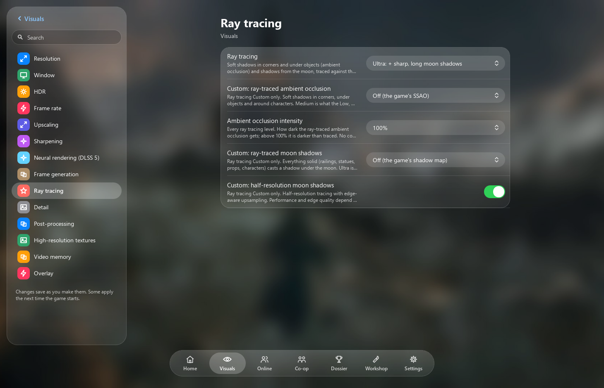</a> <b>Advanced settings</b>: One topic per section, with search. Ray tracing shown.</td>
<td width="50%" valign="top"><a href="docs/images/launcher-4.2.7-coop.png">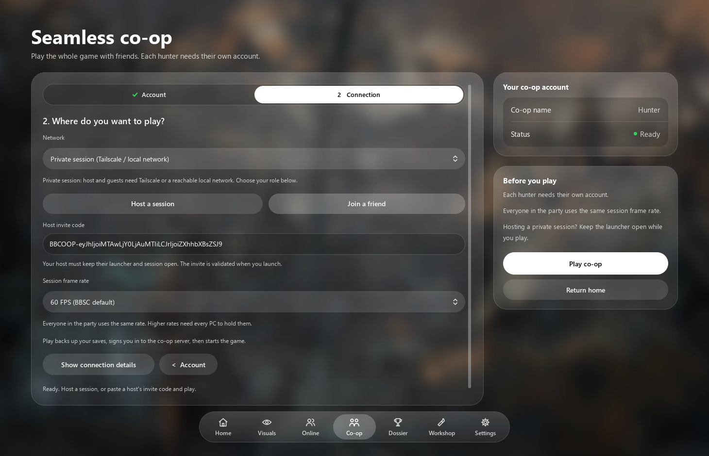</a> <b>Seamless co-op</b>: Account, then Connection: private (Tailscale) or the public server, host or join, and Play. Show connection details checks the ports.</td>
</tr>
<tr>
<td width="50%" valign="top"><a href="docs/images/launcher-4.2.7-dossier.png">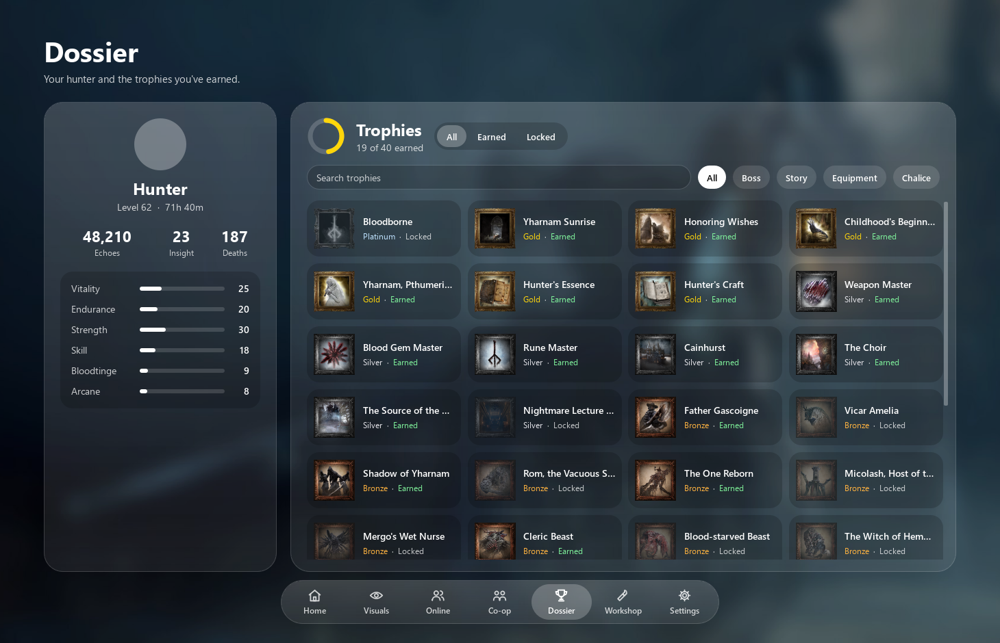</a> <b>Dossier</b>: Your hunter, attributes and every trophy, earned or locked.</td>
<td width="50%" valign="top"><a href="docs/images/launcher-4.2.7-workshop.png">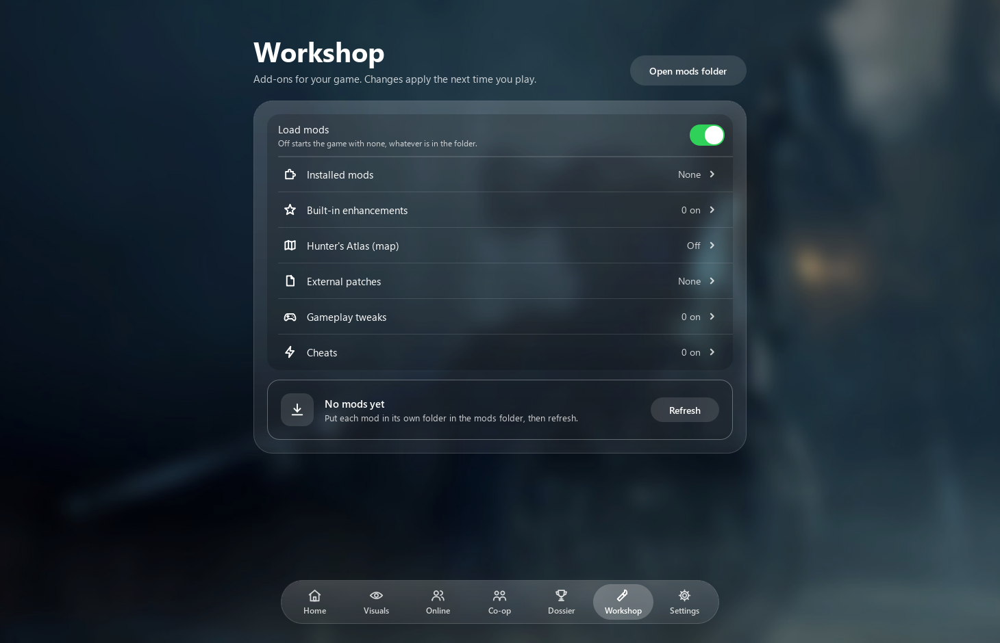</a> <b>Workshop</b>: Mods, built-in enhancements, Hunter's Atlas and patches at a glance.</td>
</tr>
<tr>
<td width="50%" valign="top"><a href="docs/images/launcher-4.2.7-online.png">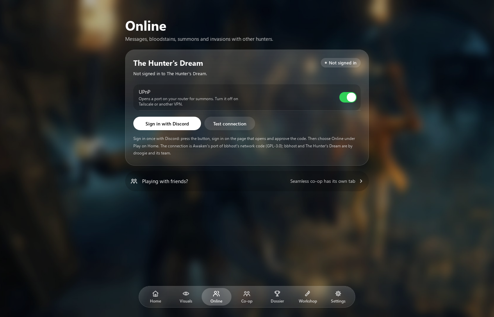</a> <b>Online</b>: The Hunter's Dream: messages, bloodstains, summons and invasions.</td>
<td width="50%" valign="top"><a href="docs/images/launcher-4.2.7-settings.png">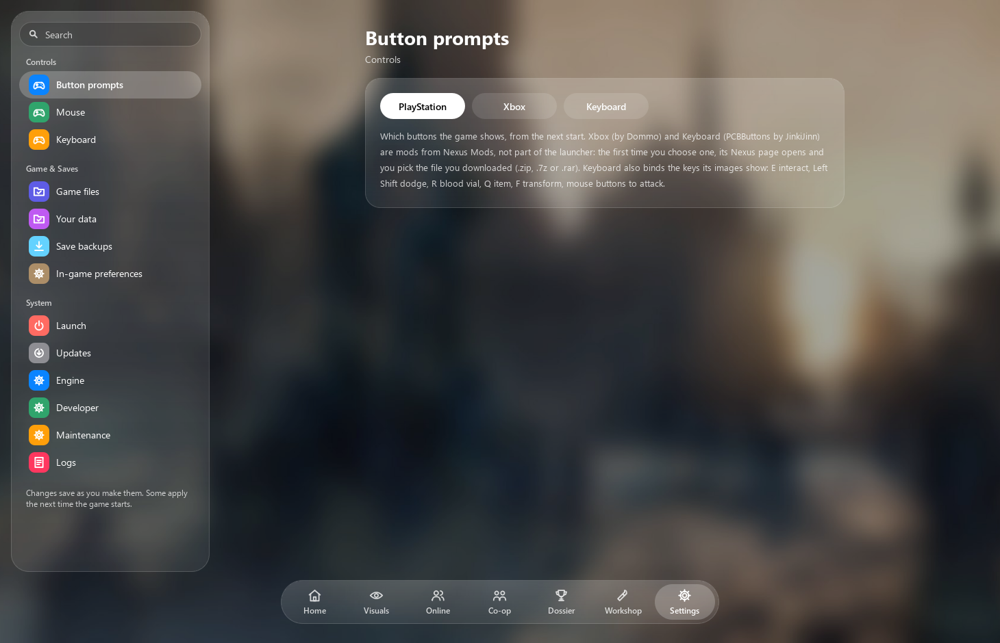</a> <b>Settings</b>: Controls, Game & Saves and System, with A− / A+ for the interface size.</td>
</tr>
<tr>
<td width="50%" valign="top"><a href="docs/images/launcher-4.2.7-whats-new.png">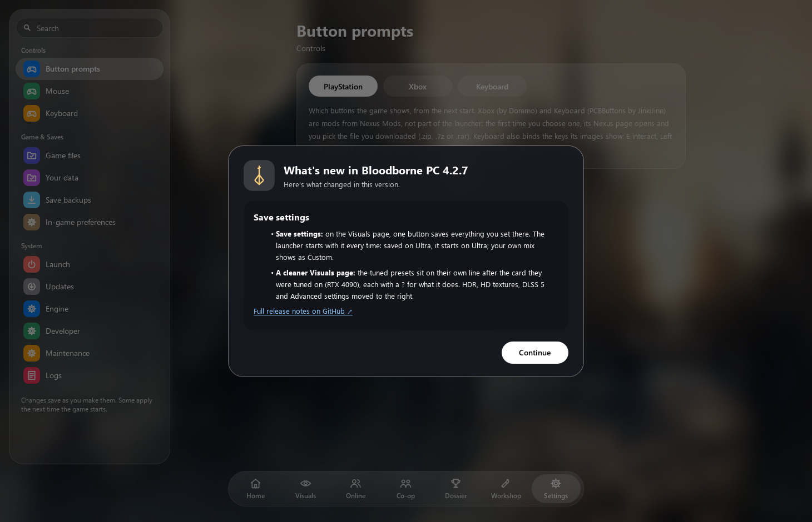</a> <b>What's new</b>: Updates and new versions show a short changelog.</td>
<td width="50%" valign="top"><a href="docs/images/launcher-4.2.7-setup.png">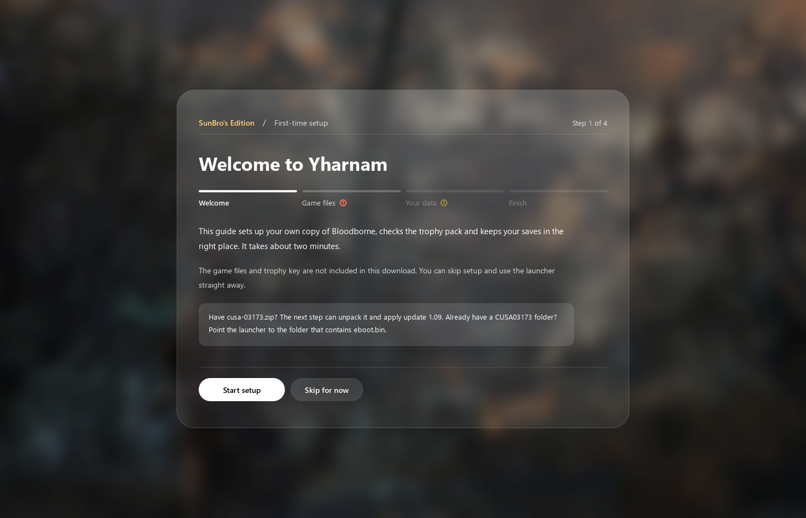</a> <b>First-time setup</b>: Game files and your data in four short steps.</td>
</tr>
</table>

## Features

| Feature | Current capability |
| --- | --- |
| Launcher | Frosted-glass Qt Quick UI over Bloodborne art: Home with quick settings, one tab bar, single-topic settings with search, Hunter profile and trophy archive. Sized to the screen and sharp at 4K (A− / A+), with update notes in the launcher. |
| Save backups | Back up now (with a label), automatic backup after each session (last 10 kept), restore with a safety backup and rollback, delete; all in Settings > Game & Saves. |
| Upscaling | DLSS model selection and Auto policy, DLSS mip bias −1 by default and live mip offset, FSR 3.1, FSR 4.1.1 on Windows through fsr4vk (experimental, one-click download; up to 1080p output on NVIDIA), FSR 1 EASU when the output is smaller than the display. |
| DLSS 5 | Neural rendering through the player's own ReShade + dlss5-bridge + renodx-dlss5 (nothing shipped); one switch, the add-on's look settings, runtime status and a DLSS 5 ready preset sized to the output (★ DLSS 5, next to Remastered's ★ DLSS 4); stays off and says why when ReShade won't load it. [Setup guide](docs/dlss5-setup.md). |
| Frame generation | DLSS-G through the NGX bridge (ABI 3: SR, FG and DLSS 5 entry points, the last unsupported until NVIDIA ships it); FSR fallback. HDR + DLSS 2× evaluation observed on RTX 4090. |
| HDR output | **BT.2020 / ST 2084 PQ, 10-bit RGB** swapchain; final conversion shared by rendered and generated frames. Paper white, peak brightness (or the display's) and highlight boost settings; physical display calibration remains pending. |
| Ray tracing | Ambient occlusion and moon shadows, quality presets, half-resolution shadows and custom reach. Reflections and secondary-light shadows remain unavailable. |
| Diagnostics | Runtime provider/fallback status, generation/presentation counters and Reflex marker intervals. |
| Hunter's Atlas | Bundled maps/art, position overlay and opt-in lamp travel. |
| Multiplayer | Offline, The Hunter's Dream online and BBSC 0.0.2 seamless co-op; co-op caps game simulation at 60 FPS. |
| Builds | MSYS2 native renderer, VS 2026 DLSS bridge, frozen launcher and ZIP packaging. |

Detailed capabilities and limits: [Feature catalog](features.md). A target FPS setting is not a sustained-performance guarantee.

## Getting started

1. Extract the complete distribution and open **Bloodborne.exe**.
2. Select your own decrypted game dump and save location in the launcher; game assets are not included.
3. Choose a hunt mode and graphics settings, save them, then launch.

For HDR, enable Windows HDR on the selected display, then **Visuals → Display & frame rate → HDR output** (paper white, peak brightness and highlight boost are just below it). Frame generation is configured in **Visuals → Frame generation**.

## Documentation

| Guide | Contents |
| --- | --- |
| [Build and packaging](build.md) | Toolchains, native/launcher builds, tests, versions and distribution checks. |
| [Launcher guide](docs/changelog/README-LAUNCHER-V30.md) | Settings, configuration, co-op and runtime diagnostics. |
| [Release notes](Release_Notes.md) / [4.0.0 changelog](docs/changelog/changelog-2026-10-29-4.0.0.md) | Version history; 4.0.0's save backups, HDR levels, DLSS 5 neural rendering and FSR 4.1.1. |
| [DLSS 5 setup](docs/dlss5-setup.md) | The files DLSS 5 neural rendering needs (ReShade, dlss5-bridge, renodx-dlss5, `nvngx_dlssnr.dll`), where they go and how to check it works. |
| [DLSS 4.5 vs DLSS 5 at 4K](docs/dlss-4.2.0-comparison.md) | 4.2.0's measurements on an RTX 4090: every DLSS tier with and without frame generation, DLSS 5, frame times, power and screenshots, with the recommended settings. |

Source lives in `bloodborne_pc/` ([port README](bloodborne_pc/README.md), with every third-party package it uses). This is a custom build; see the upstream [port](https://github.com/Jgamrot/bloodborne_pc) and [BBSC](https://github.com/CLSAMG22/BBSC) projects for their work.

## License

GNU General Public License v3.0 or later: see [LICENSE](LICENSE). Third-party packages keep their own licences; see the [port README](bloodborne_pc/README.md#third-party-packages).
