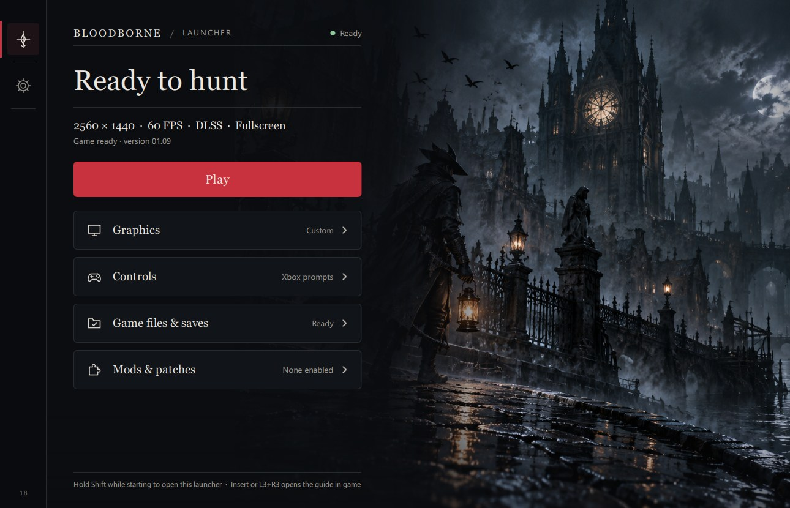
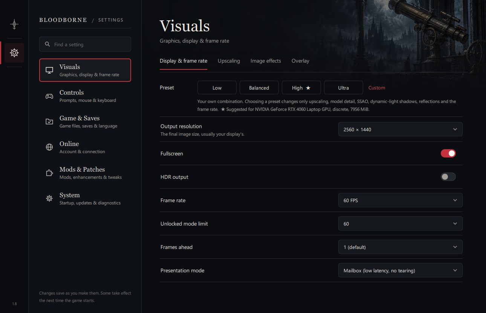
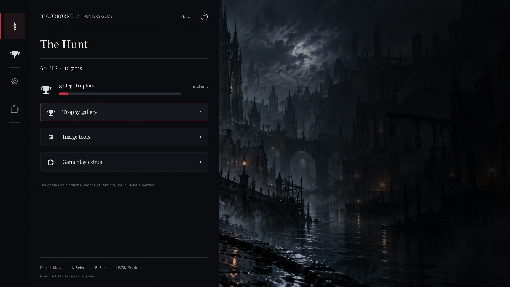
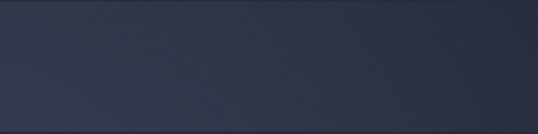
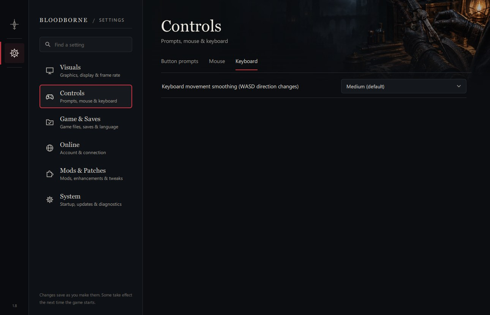

# Bloodborne for Windows (Jgamrot fork)

Run your own decrypted copy of Bloodborne (CUSA03173, version 1.09) natively on Windows 10 or 11.
The game's own code runs directly on your CPU and its graphics are translated to Vulkan. This
fork is based on [Supermedo's Windows port](https://github.com/Supermedo/bloodborne_pc) by
Mohammed Albarghouthi, which builds on [deadinside28's bbport](https://github.com/deadinside28/bloodborne_pc)
and the [shadPS4](https://github.com/shadps4-emu/shadPS4) renderer.

**Current version: 4.2.15** (Sojin Chikage, a twin-blade Chikage the Bath Messengers sell).
See the [release notes](../Release_Notes.md), the [4.2.15 changelog](../docs/changelog/changelog-2026-11-01-4.2.15.md),
[all versions](../docs/changelog/README.md) and [DLSS 4.5 vs DLSS 5 at 4K](../docs/dlss-4.2.0-comparison.md).

> **No game files are included.** You need your own dump of Bloodborne. This project is not
> affiliated with Sony Interactive Entertainment or FromSoftware.



## Download

From the [latest release](https://github.com/wanderabyss/sunbros-bloodborne-launcher/releases/latest), download
**`bbport-windows-<version>.zip`** (for example `bbport-windows-4.2.15.zip`; its SHA-256 is in the
release notes) and extract the whole archive. The two **Source code** downloads are for developers.
Previews of upcoming features are marked *Pre-release* on the
[releases page](https://github.com/wanderabyss/sunbros-bloodborne-launcher/releases).

## Features

**Launcher and setup**
- A setup wizard on first start that installs the game from your own ZIP or PKG dump, checks
  the game files, saves and trophy key, and can be reopened from **Game → Setup wizard**.
- Every setting in one place: graphics, display, game, controller, cheats, online and mods.
- `Play Bloodborne.exe` starts the game straight away with your saved settings.
- Update notifications for full releases.
- **Save backups** (**Settings > Game & Saves > Save backups**): back up now with an optional
  label, an automatic backup each time the game closes (the last 10 are kept; your own are never
  deleted), and restore, which first backs up the current saves and puts them back if anything
  fails. Each backup lists its date, kind, size and characters.

**Graphics & Visuals**
- **Vulkan Ray Tracing**: Real-time Ray-Traced Ambient Occlusion (RTAO) and directional Moon Shadows. Ray-traced water reflections and dynamic secondary lights are not implemented.
- **RTG-5 Anti-Ghosting**: 3×3 color neighborhood history clamp in `rt_filter.comp` eliminating ghost trails on fast-moving casters and dynamic cloaks.
- **True HDR (Rec. 2020)**: Native `VK_COLOR_SPACE_HDR10_ST2084_EXT` support with SMPTE ST 2084 PQ EOTF and custom luminance tonemapping for Bloodborne's deep blacks and incandescent firelight. **HDR paper white**, **peak brightness** (up to 4000 nits, or the display's) and **highlight boost** are set in **Visuals > Display & frame rate > HDR output** (`hdr_white_nits`, `hdr_peak_nits`, `hdr_highlight_boost`).
- **Profile-Guided Optimization (PGO) & ThinLTO**: Binaries compiled with Clang ThinLTO and profile-guided optimization ingesting 108B execution counts across 18,203 functions from in-game tours.
- NVIDIA DLSS (GeForce RTX 20 series and newer), AMD FSR 3.1, FSR 4 and FSR 4.1.1 (experimental on Windows, through [fsr4vk](https://github.com/dvj5411/fsr4vk): **Visuals > Upscaling > Download FSR 4.1.1**; up to 1080p output on NVIDIA), native-resolution TAA, DLSS and FSR 3.1 Frame Generation, and NVIDIA Reflex low latency (On / Boost).
- **DLSS 5 neural rendering** (community route, RTX 40 / 50): with your own `nvngx_dlssnr.dll`,
  ReShade and the dlss5-bridge and renodx-dlss5 add-ons in `bin\`, the switch in **Visuals >
  Neural rendering (DLSS 5)** turns it on and sets the add-on's look (NR upscaling, intensity,
  style, structure, tone…). The **DLSS 5 ready** preset picks settings that hold 60 → 120 FPS for
  your output size; on RTX 40 / 50 cards with 12 GB it is marked **★ DLSS 5**, and Remastered
  **★ DLSS 4**. If ReShade isn't set to load for this folder, DLSS 5 stays off and the launcher
  says so. The port never ships or downloads these files: see
  [Setting up DLSS 5 neural rendering](../docs/dlss5-setup.md) for what you need and where it goes.
- Output below the display (for example 1440p on a 4K screen) is upscaled with AMD FSR 1 EASU
  instead of a bilinear stretch, with optional RCAS sharpening.
- Output from 720p to 4K (any custom `output_res` from 256x144 to 7680x4320), fullscreen switchable while playing, 30/60/90/120 FPS or unlocked with a cap.
- The game's effects on or off: chromatic aberration, depth of field, motion blur, SSAO, the
  game's AA, dynamic shadows, screen-space reflections, model detail.
- Shader pre-build: shaders the game is known to use are built while it starts (*Preparing
  shaders* in the window title) instead of stuttering the first time an area or effect appears.
  The included catalog covers the game up to the Blood-starved Beast so far; it lists shaders,
  not game code, and each install builds them from its own files. Off with `BB_SHADER_PREBUILD=0`.



**In the game**
- PC settings in the game's own System menu: PC Graphics, Display, Effects, Settings and
  Gameplay, Achievements, and Restart to Apply. Quit Game on the title screen.
- The **Insert** / **L3+R3** guide: FPS, achievements with icons and Gamerscore, all settings,
  mods and cheats. Achievement toasts when a trophy unlocks, with your own sounds, pictures,
  animations and texts if you like ([below](#custom-trophy-notifications)).

**Controls**
- Controller, and keyboard and mouse at the same time, with rebindable keys
  (`key_<action>=` lines in `bbport.ini`).
- Mouse camera: click the game window and the mouse turns the camera 1:1. Sensitivity and
  invert Y are in **Settings > Controls > Mouse**. Locked on, a quick sideways flick of the
  mouse switches targets, as in Dark Souls III.
- Keyboard movement smoothing: changing direction with WASD swings smoothly instead of
  stopping for a moment (**Settings > Controls > Keyboard**, *Off* to disable).
- Button prompts: PlayStation, Xbox or keyboard keys (see below), switchable in the launcher
  and the guide. Xbox and keyboard prompts are Nexus Mods downloads the launcher adds for you.

**Optional enhancements** (off by default; switch them on in the launcher's **Mods** page or
the guide. They are made from your own game files at start, which stay unchanged.)
- **Lamps: Level Up and Storage** (`pc_enhanced_lamps`): every lit lamp also offers the game's
  own level-up and storage screens, once you have used the Doll and the storage box.
- **Rebirth in the Nightmare** (`pc_rebirth`): reallocate your stats at the Altar of Despair.
- **Hunter's Dream mirror** (`pc_mirror_appearance`): the workshop mirror opens the appearance
  editor, the developers' unused "Put on Disguise".
- **Two invaders** (`pc_two_invaders`) in Mensis, Mergo's Loft, the Nightmare Frontier and the
  Old Hunters' areas. Every player in a session needs it on.
- **Sojin Chikage** (`pc_sojin_chikage`): the Chikage reforged as twin blades. Normal mode is
  the Chikage's katana; trick mode is the Blade of Mercy's twin-blade moveset with a blood hit
  on every cut, plus Blood Rhythm, Blood Crescent and Bankai. The Bath Messengers sell it, its
  Uncanny and its Lost version at +0 for 10,000 Blood Echoes each (in ShopEdit's shop when
  ShopEdit is on). Every player in a session needs it on. Switched off, the launcher turns
  the weapons in your saves into the Chikages they were made from (a backup stays beside the
  save folder).

**Also**
- Online play (beta): messages, bloodstains and ghosts through
  [The Hunter's Dream](https://thehuntersdream.com), and co-op through a shadNet server.
- Death respawns skip the game's fixed 12-second wait.
- Mods and third-party patches, loaded without changing your game files.
- The Old Hunters on base-game dumps, with a DLC folder setting.

What changed in each release: [Release Notes](../Release_Notes.md) and [Changelogs](../docs/changelog/).



## First-time setup

1. Right-click **`bbport-windows-<version>.zip`** and choose **Extract All**. Put the
   `bbport-windows-<version>` folder somewhere permanent, such as
   `C:\Games\Bloodborne\bbport-windows-4.2.15`. Do not run the game
   from inside the zip.
2. Double-click **Bloodborne.exe**. The setup wizard opens on a new install; **Skip setup** goes
   straight to the launcher.
3. In the wizard's **Game** step, either:
   - click **Install from ZIP / PKG** and choose your dump (for example `cusa-03173.zip`) and a
     destination such as `C:\Games\Bloodborne`. The base game and the plain 1.09 update are
     extracted into `CUSA03173`; allow about 70 GB free for a 30 GB archive. Or
   - click **Choose existing game folder** and pick the folder with `eboot.bin` directly inside.
4. On **Your data**, optionally import your own `keys.json` (for achievement names) or choose an
   existing saves folder. The checks turn green when the game folder has version 1.09; amber is
   normal for a new install without saves.
5. Click **Play now**. The first launch prepares files and builds the known shaders
   (*Preparing shaders: N%* in the window title), so it takes a while; later starts are quick.


```text
C:\Games\Bloodborne\
├── bbport-windows-4.2.15\
│   ├── Bloodborne.exe
│   └── bin\bb-probe.exe
└── CUSA03173\                 ← the Game folder
    ├── eboot.bin
    ├── dvdroot_ps4\
    ├── sce_module\
    └── sce_sys\
```

If the launcher says **No eboot.bin**, you chose the wrong folder. If it reports version 1.00,
the 1.09 update did not apply.

**DLC.** The Game of the Year edition (CUSA03173) already includes The Old Hunters. With a
base-game dump, dump your add-ons too: each is a folder named like `SPEXPANSIONDLC03` with only
`sce_sys` inside. Put them in one folder and choose it as **DLC folder** on the **Game** page.

**Achievements.** Names, descriptions and Gamerscore need the trophy key from your own PS4 in
`user\keys.json` (shadPS4's format, `{"TrophyKeySet":{"ReleaseTrophyKey":"..."}}`). Without it,
achievements show their numbers and icons. Nothing syncs to PlayStation Network.

## Custom trophy notifications

In the guide (**Insert** / **L3+R3**), **Achievements > Trophy notifications** lets you pick a
theme, set the sound and how long it stays on screen, and preview each grade. Previews don't
unlock or save anything.

- **Original banner**: the green banner at the bottom (default).
- **Card**: a dark card at the top right. The platinum has a short animation.
- **Card, cinematic platinum**: same, with a longer, brighter platinum.
- **Corner popup**: rises from the bottom right corner, with the trophy's name and description.

Turn off *Animate the platinum* to show the platinum's own artwork instead.



You can also add your own files to `user\custom_trophy` (it's inside your saves folder, so move
it along with them). None are needed and the port ships none.

| File | What it does |
|---|---|
| `bronze`, `silver`, `gold`, `platinum` + `.mp3` `.wav` `.ogg` `.flac` `.m4a` `.opus` | Sound for that grade. `trophy.*` covers any grade without its own. Up to 20 seconds. |
| `<grade>_anim.gif` (or `.apng` `.png` `.jpg` `.webp` `.bmp`) | Picture or animation for that grade in Card and Corner. Plays once and stops on the last frame. `trophy_anim.*` covers the rest. Up to 600 frames and 20 seconds. |
| `<grade>_anim.ini` | `loop=1` repeats it, `delay_ms=` starts it later. `frames=`, `columns=` and `fps=` read the `.png` as a sprite sheet. |
| `badge.png` | The disc on the right of the card. |
| `font.ttf` (or `.otf`), `font-light.ttf` | Fonts for Card and Corner. Default on Windows: Segoe UI. |
| `notifications.ini` | The guide's options, plus your own texts: `text_unlocked=`, `text_banner=`, `name_bronze=` … `name_platinum=`. Edit it with the game closed. |

Sounds, pictures and grade names per grade need the trophy key (see *Achievements* above).
Without it, only `trophy.*` is used on a real unlock; previews still show each grade.

Example, Portuguese texts and a looping platinum:

```text
user\custom_trophy\
├── notifications.ini      theme=card_cinematic
│                          text_unlocked=Troféu conquistado!
│                          name_platinum=Platina
├── platinum_anim.gif
├── platinum_anim.ini      loop=1
├── platinum.ogg
└── trophy.wav             (every other grade)
```

**Reload sounds** in the guide picks up new sounds. Everything else is read when the game
starts. Files that can't be read are listed in `user\last_run.log`.

## Keyboard button prompts

Choose **Keyboard** in the launcher (**Settings > Controls**). The key images are
[PCBButtons](https://www.nexusmods.com/bloodborne/mods/460) by **JinkiJinn**. They are an edit
of the game's own menu file, so the port does not include them: the first time you choose
Keyboard, the mod's Nexus page opens; download it and pick the downloaded file (.zip, .7z or
.rar) in the dialog. Xbox prompts work the same way, from Dommo's
[Xbox (and switch) UI for Bloodborne](https://www.nexusmods.com/bloodborne/mods/30) (if the
download has several styles, unpack it and pick the `common.tpf.dcx` of the one you want).
Choosing Keyboard also sets your
keys to the ones the images show: E interact, Left Shift dodge, R blood vial, Q item,
F transform, left / right / middle mouse for attack / firearm / lock-on, Left Ctrl + left mouse
for strong attack, Space for L3, G and H for gestures and personal effects. Switch back to
PlayStation or Xbox in the launcher or the guide's **Mods** tab at any time.



## Already have another launcher or game installation?

Keep your extracted game folder where it is; there is no need to extract it again.

1. Close the game and the old launcher, and back up the old launcher's `user` folder (saves,
   trophies, `keys.json`), its `bbport.ini` and its `mods` folder.
2. Extract this package to a **new** folder and run its `Bloodborne.exe`. Do not copy only
   `Bloodborne.exe` into an older port.
3. On **Game**, set **Game folder** to your existing folder with `eboot.bin`, and **Saves folder**
   to your existing `user` folder (or copy your saves into the new one while everything is
   closed). Keep the backup until your character loads.
4. Copy over the mods you still want and enable them under **Mods**.

## Settings for advanced users

Game settings are stored in `bbport.ini` and launcher settings in
`%APPDATA%\bbport-launcher\settings.json`. Environment overrides on the launcher's **Advanced**
page take precedence:

| Setting | `bbport.ini` | Override |
|---|---|---|
| Lamps: Level Up and Storage | `pc_enhanced_lamps=1` | `BB_PC_LAMPS=1` |
| Rebirth | `pc_rebirth=1` | `BB_PC_REBIRTH=1` |
| Hunter's Dream mirror | `pc_mirror_appearance=1` | `BB_PC_MIRROR=1` |
| Two invaders | `pc_two_invaders=1` | `BB_PC_TWO_INVADERS=1` |
| Sojin Chikage | `pc_sojin_chikage=1` | `BB_PC_SOJIN=1` |
| Mouse camera | `mouse_camera=0` turns it off | `BB_MOUSE_CAMERA=0` |
| Mouse flick that switches lock-on targets (mouse counts; higher needs a bigger flick) | `mouse_flick_threshold=300`, `0` turns it off | `BB_MOUSE_DEBUG=1` logs it |
| Mouse pointer in the game's menus | `mouse_menu=0` turns it off | `BB_MOUSE_MENU=0` |
| 12-second respawn wait | | `BB_RESPAWN_DELAY_FIX=0` restores it |
| Strict frame cap (no single frame faster than the cap) | | `BB_STRICT_FRAME_CAP=0` |
| High-FPS sprint fix | `sprint_fix=0` turns it off | `BB_SPRINT_FIX=0` |
| Ultrawide camera and centered HUD (non-16:9 outputs) | `output_res=16:9 size` | `BB_ASPECT=0` |
| Indirect dispatch guard (skips implausible GPU work counts) | | `BB_INDIRECT_GUARD=0` |
| Pad stick neutral and travel per controller (clone pads) | | `BB_PAD_CENTER_CAL=0`, `BB_PAD_DEADZONE`, `BB_PAD_CENTER` |
| Safe saves (write to a copy, then replace) | | `BB_SAFE_SAVES=0` |
| Xbox pads: Back + d-pad left/right for the touchpad halves | | `BB_PAD_BACK_COMBO=0` |
| Skip draws that cannot change anything | | `BB_SKIP_EMPTY_DRAWS=0` |
| All engine hooks (in-game menus and features) | | `BB_ENGINE_HOOKS=0` |

## Known issues

- Character creation could show a blank or ghosted preview on the first visit; 1.6.12 and 1.6.13
  previews include a fix that still needs confirming in play. Backing out and choosing New Game again
  restores it.
- Rebirth and two invaders have not been tested in play yet; Sojin Chikage not in co-op yet.
- Keep the frame cap at 120 FPS or lower. The sprint fix removes the known half-speed sprint
  above it, but higher caps are not tested yet.
- Areas and effects beyond the shader catalog (so far, after the Blood-starved Beast) still
  stutter briefly the first time while their shaders compile; later releases extend the catalog.
  On AMD and Intel GPUs most fragment shaders still compile in play. On a black screen, try
  **Advanced → Clear shader cache**.
- Occasional "exploded" character faces: set **GPU readbacks** to **Precise** (Settings > System > Engine);
  it costs some speed.

## Requirements

- Windows 10 (1903 or later) or Windows 11, 64-bit, and a graphics card with Vulkan 1.3.
- An Intel Core 4th generation (Haswell, 2013) or newer, or an AMD Ryzen: the game uses
  instructions of the PS4's processor (AVX, BMI1, MOVBE, LZCNT). Intel 2nd and 3rd generation
  (Sandy and Ivy Bridge, many Xeon E5 v1/v2) run with those instructions translated, best effort;
  CPUs without AVX cannot run the game.
- About 6 GB of available memory (RAM plus page file), 10 GB for 1440p or 4K output.
- DLSS needs an NVIDIA GeForce RTX 20 series or newer, DLSS Frame Generation an RTX 40 or newer;
  FSR works on other cards. DLSS 5 neural rendering needs files you supply yourself (see Features).

## Help and source

- Problems: open an [issue](https://github.com/wanderabyss/sunbros-bloodborne-launcher/issues) with your graphics
  card, what happened, and `user\last_run.log` from the `bbport-windows-<version>` folder.
- Building: [packaging/windows/README.md](packaging/windows/README.md) and the repository's
  [build guide](../build.md).

## Contributing

Bug reports, fixes and features are welcome.

1. **Report first.** Open an [issue](https://github.com/wanderabyss/sunbros-bloodborne-launcher/issues) with your
   graphics card and driver, the package version (`version.txt`, shown on the launcher's home page),
   what happened, and `user\last_run.log`. For graphics problems, add the launcher's settings
   (Visuals page) or your `bbport.ini`.
2. **Branch and build.** Fork, branch from `main`, and build as in the [build guide](../build.md)
   (MSYS2 CLANG64 for the game, Visual Studio 2026 C++ Build Tools for the DLSS bridge, a Windows
   Python 3.11+ with `pip install -e ".[dev]"` for the launcher).
3. **Test.** Run the Python suite (`python -m pytest bloodborne_pc/tests`) and the native
   `*-test` targets. Changes to rendering, upscaling or frame generation should
   also say what was checked in game: GPU, output size, settings and the FPS / failed-present
   counters from the overlay or `last_run.log`.
4. **Keep it clean.** No game files, keys, saves, NVIDIA / AMD runtime DLLs beyond what their
   licences allow, or third-party mod files. Mark local changes to vendored shadPS4 code with a
   `bbport:` comment (see [gpu/VENDOR.txt](gpu/VENDOR.txt)). Add a line to
   [Release_Notes.md](../Release_Notes.md) for anything a player will notice.
5. **Open a pull request** against `main` describing the change, why, and how it was tested.

Contributions are accepted under the repository's [LICENSE](LICENSE) (GPL-3.0-or-later); code taken from other
projects must keep its author and licence and be listed under *Third-party packages* below.

## Third-party packages

The port is built from, links or loads the following. Licence texts ship in the release's
`licenses` folder.

**Graphics, upscaling and frame generation**

| Package | Used for | Licence |
|---|---|---|
| [shadPS4](https://github.com/shadps4-emu/shadPS4) (commit `b4e7ae7`, see [gpu/VENDOR.txt](gpu/VENDOR.txt)) | Vulkan renderer, shader recompiler, video output | GPL-2.0-or-later |
| [NVIDIA DLSS SDK](https://github.com/NVIDIA/DLSS) (`nvngx_dlss.dll`, `nvngx_dlssg.dll`) | DLSS Super Resolution, DLSS Frame Generation | NVIDIA RTX SDK licence |
| [NVIDIA Streamline](https://github.com/NVIDIA-RTX/Streamline) 2.14.16 (`bin\streamline`) | Optional DLSS backend (`BB_DLSS_BACKEND=streamline`) | NVIDIA Streamline licence |
| [NVIDIA Reflex](https://developer.nvidia.com/performance-rendering-tools/reflex) (through the DLSS / Streamline SDKs) | Low-latency mode | NVIDIA RTX SDK licence |
| [AMD FidelityFX SDK](https://github.com/GPUOpen-LibrariesAndSDKs/FidelityFX-SDK) 1.1.4 / 2.3 subsets via [FSR-Vulkan](https://github.com/FireBurn/FSR-Vulkan) ([gpu/third_party/fsr-vulkan](gpu/third_party/fsr-vulkan)) | FSR 3.1 upscaling, optical flow and frame generation, FSR 4 INT8 | MIT |
| [AMD FidelityFX FSR 1](https://github.com/GPUOpen-Effects/FidelityFX-FSR) (EASU + RCAS, in shadPS4) | Present upscale when the output is smaller than the display | MIT |
| [fsr4vk](https://github.com/dvj5411/fsr4vk) v0.4.3 + AMD driver fix (downloaded on request, SHA-256 checked; loader ported from [0xCydral/bloodborne_pc](https://github.com/0xCydral/bloodborne_pc)) | FSR 4.1.1 on Windows | see the project |
| [Vulkan SDK](https://vulkan.lunarg.com/) / [glslang](https://github.com/KhronosGroup/glslang) | Graphics API, shader compilation at build time | Apache-2.0 / BSD |
| [Vulkan Memory Allocator](https://github.com/GPUOpen-LibrariesAndSDKs/VulkanMemoryAllocator) | GPU memory | MIT |
| [sirit](https://github.com/shadps4-emu/sirit) | SPIR-V emission in the shader recompiler | BSD-3-Clause |

**Not shipped; supplied by the player** (DLSS 5 community route): [ReShade](https://reshade.me/)
with the dlss5-bridge add-on, [RenoDX](https://github.com/clshortfuse/renodx)'s renodx-dlss5 add-on, and
NVIDIA's `nvngx_dlssnr.dll`. Also player-supplied: [PCBButtons](https://www.nexusmods.com/bloodborne/mods/460)
and [Xbox (and switch) UI for Bloodborne](https://www.nexusmods.com/bloodborne/mods/30) button prompts.

**Engine, input, audio and networking**

| Package | Used for | Licence |
|---|---|---|
| [SDL3](https://github.com/libsdl-org/SDL) | Window, input, controllers, HDR display levels | Zlib |
| [FFmpeg](https://ffmpeg.org/) | Movies and trophy sounds | LGPL-2.1+ |
| [LibAtrac9](https://github.com/Thealexbarney/LibAtrac9) ([third_party/LibAtrac9](third_party/LibAtrac9)) | ATRAC9 audio | MIT |
| [Zydis](https://github.com/zyantific/zydis), [xbyak](https://github.com/herumi/xbyak) | x86 decoding and code generation (CPU instruction fallbacks, hooks) | MIT / BSD-3-Clause |
| [Dear ImGui](https://github.com/ocornut/imgui) | In-game guide and overlay | MIT |
| [fmt](https://github.com/fmtlib/fmt), [Boost](https://www.boost.org/), [robin-map](https://github.com/Tessil/robin-map), [magic_enum](https://github.com/Neargye/magic_enum), [half](https://half.sourceforge.net/), [xxHash](https://github.com/Cyan4973/xxHash) | Support libraries | MIT / BSL-1.0 / BSD-2-Clause |
| [miniz](https://github.com/richgel999/miniz), [zlib](https://zlib.net/) | Compression | MIT / Zlib |
| [cpp-httplib](https://github.com/yhirose/cpp-httplib), [OpenSSL](https://www.openssl.org/), [wepoll](https://github.com/piscisaureus/wepoll), [Protocol Buffers](https://github.com/protocolbuffers/protobuf), [nlohmann/json](https://github.com/nlohmann/json) | Online play (shadNet, The Hunter's Dream) | MIT / Apache-2.0 / BSD-2-Clause / BSD-3-Clause / MIT |
| [BBSC](https://github.com/CLSAMG22/BBSC) 0.0.2 | Seamless co-op | GPL-2.0-or-later |
| [DejaVu fonts](https://dejavu-fonts.github.io/) | Overlay text | Bitstream Vera / public domain |

**Launcher and tools**

| Package | Used for | Licence |
|---|---|---|
| [Qt 6](https://www.qt.io/) / [PySide6](https://doc.qt.io/qtforpython-6/) | Qt Quick launcher | LGPL-3.0 |
| [PyInstaller](https://pyinstaller.org/) | Frozen `Bloodborne.exe` | GPL-2.0 with bootloader exception |
| [Pillow](https://python-pillow.org/), [psutil](https://github.com/giampaolo/psutil), [Requests](https://requests.readthedocs.io/), [urllib3](https://github.com/urllib3/urllib3), [certifi](https://github.com/certifi/python-certifi), [packaging](https://github.com/pypa/packaging) | Images, process checks, downloads | MIT-CMU / BSD-3-Clause / Apache-2.0 / MIT / MPL-2.0 / Apache-2.0 |
| [Keystone](https://www.keystone-engine.org/) | Assembling patches at build time | GPL-2.0 |
| [ShadPs4Plus PKG Extractor 1.1](https://github.com/AzaharPlus/shadPS4Plus) | Installing your dump | GPL-2.0 |
| [Hunter's Atlas](https://github.com/MikeTat1988/HuntersAtlas) | Full-screen map | GPL-2.0 |
| [MSYS2](https://www.msys2.org/) / [LLVM Clang](https://llvm.org/) (ThinLTO, PGO), Visual Studio | Toolchains | — |

## Credits

- [Supermedo](https://github.com/Supermedo/bloodborne_pc) (Mohammed Albarghouthi) for the Windows
  port, [deadinside28](https://github.com/deadinside28/bloodborne_pc) for bbport, and the
  [shadPS4 team](https://github.com/shadps4-emu/shadPS4) for the renderer and shader recompiler.
- [droogie's bbhost](https://github.com/droogie/bbhost) for the in-engine PC menus, Rebirth,
  the mirror, two invaders and keyboard prompt text.
- Online: the network, NP and shadNet code of [shadPS4](https://github.com/shadps4-emu/shadPS4)
  0.20, put together for the port by **Awaken** ([BloodBorneButPc](https://github.com/Awakenchan/BloodBorneButPc))
  with the backend for [The Hunter's Dream](https://thehuntersdream.com) (Discord
  sign-in on the Online page) adapted from bbhost's network code (GPL-3.0-or-later), taken in through
  Supermedo's port; see [gpu/bbnet/SHADNET-PORT.md](gpu/bbnet/SHADNET-PORT.md) and
  [gpu/bbnet/THD-PORT.md](gpu/bbnet/THD-PORT.md). Thanks to Metr1k and The Hunter's Dream team, and
  to Wozzardman's [shadp2p](https://github.com/Wozzardman/shadp2p), which the first online version
  was built on.
- [Hunter's Atlas](https://github.com/MikeTat1988/HuntersAtlas), the full-screen map, by MikeTat1988
  (GPL-2.0); see [tools/atlas/README.md](tools/atlas/README.md).
- Frame generation from Supermedo's port, and fixes from more of its pull requests: emurphy04
  (ultrawide, live resolution), EricDar12, DarkSpartan, k1m0206, andrecabralgit,
  fliperama86, parsifal295, T0ug (older processors) and cassioKenji (keyboard sprint).
- Fixes and features from Supermedo pull requests, kept with their authors' commits: ayozetr
  (DLC), DarkSpartan, gtggdd4mzb-source and yumlevi, andrecabralgit, noatdk, FIocker (including
  the English menu), jpramosjp and gStone.
- The mouse camera by imedved (Nexus Mods), ported by mcrib884 and Jhony-Jhansen.
- Xbox prompts by **Dommo**, from [Xbox (and switch) UI for Bloodborne](https://www.nexusmods.com/bloodborne/mods/30),
  and keyboard prompts by **JinkiJinn**, from [PCBButtons](https://www.nexusmods.com/bloodborne/mods/460):
  supported by the launcher, downloaded by each player from Nexus Mods.
- The respawn fix after [AwesomeObserver's Windows work](https://github.com/AwesomeObserver/bloodborne_pc/blob/windows/docs/respawn-loading-windows.md).
- [ShadPs4Plus PKG Extractor 1.1](https://github.com/AzaharPlus/shadPS4Plus) by AzaharPlus
  (GPL-2.0), included for installing your dump.
- [Bloodborne Enhanced](https://www.nexusmods.com/bloodborne/mods/19) inspired the lamp and
  rematch features, which are implemented independently; its files are not used or included.
  It can still be installed manually as a mod.
- **Exit Game 1.01** by **Nerkuu**: a title-menu Exit Game patch. Not shipped since 4.2.7 (public redistribution needs the author's permission); players who have it can drop `Bloodborne_exit_game.xml` into the external patches folder (Workshop > External patches) and switch it on there.

The port is free software under the GNU GPL v3 or later ([LICENSE](LICENSE)); parts of it are GPL-2.0-or-later ([GPL v2 text](licenses/GPL-2.0.txt)), and the combined program is GPL v3; third-party notices are in
the release's `licenses` folder. Bloodborne belongs to Sony Interactive Entertainment and
FromSoftware.
