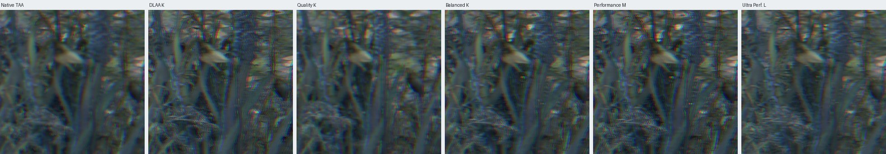
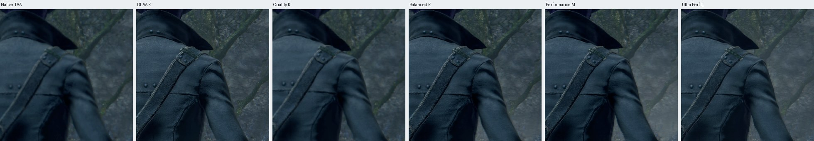
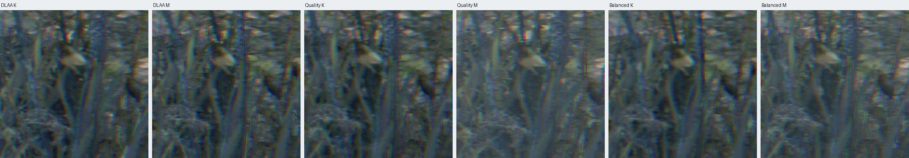
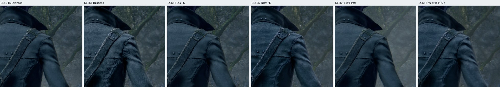
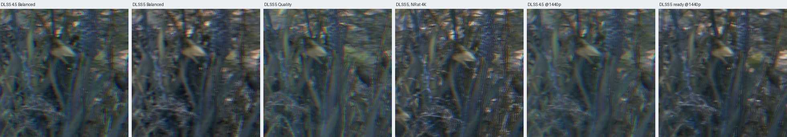

# DLSS 4.5 vs DLSS 5 at 4K on an RTX 4090 (4.2.0)

**Recommendation in one line:** at 4K on an RTX 4090, use DLSS 4.5 Super Resolution at **Quality** (now model K through `dlss_model=auto`), with DLSS frame generation for 60 → 120. Keep DLSS 5 for **2560 × 1440 output** (the "DLSS 5 ready" preset). At 4K output, DLSS 5 holds 60 only with NR upscaling at Balanced or below, and holds 60 → 120 with frame generation only at Ultra Performance.

## How it was measured

- **Machine:** RTX 4090 (driver 621.01), AW3225QF 3840 × 2160 display, borderless fullscreen at 3840 × 2160 output (no present resampling: "Present upscale: 3840x2160, same size as the display frame").
- **Build:** this branch's `bb-probe.exe` (PGO + LTO) in a copy of the 4.1.0 package's `bin` (`nvngx_dlss.dll` / `nvngx_dlssg.dll` 310.9.16). DLSS 5 runs use the same build with the community route in the one `bin` ReShade's app list allows: `dlss5-bridge` 1.4.13-pre8, `renodx-dlss5` 2.5, `nvngx_dlssnr.dll` 310.8.0, with the kit's NR look (Cinematic style, local structure 2.00).
- **Settings**: ray tracing off, depth of field on, screen-space reflections on (`effect_ssr=1`; the port's default is off), port sharpening off, SDR, FPS counter off, 60 FPS cap, Reflex on, `cheat_stealth` / `cheat_no_death` so enemies never interrupt the route. Per run only `upscaler`, `preset`, `frame_gen`, `dlss_model` and `dlss5` change.
- **Route**: Hunter's Atlas travel to the Forbidden Woods lamp (grass, trees, ivy, the hunter's coat and hat), a still and a frame dump at the arrival pose, a dump while the camera turns, a measured walk-and-turn segment (`fw-walk`, ~16 s) and a still-camera segment at a second viewpoint (`fw-idle`, 15 s). One launch per configuration, about 4 minutes each.
- **Live sweeps** (`sweep45`, `sweep5`, `sweep5out`, `sweep5ready`): one launch each, the camera parked at the arrival pose, every tier and model switched live (`BB_PRESET_FILE`), 8 s measured per configuration: GPU time on exactly the same view and pixel-matched stills. Live tier changes at 4K need `live_resolution=1`, so the sweeps run with depth of field off.
- **Per frame:** `BB_FRAME_TIMES` (new) logs every game flip and every accepted present. 1% / 0.1% low = 1000 / the 99th / 99.9th percentile game frame time. FT SD = standard deviation of game frame times.
- **GPU time:** `BB_GPU_PROFILE` windows (2 s, median): GPU busy = frame time minus the idle line. "Eval" is the `upscaler: evaluate` label: DLSS Super Resolution, plus DLSS 5's NR when the community route runs (it runs inside the game's DLSS call).
- `nvidia-smi` every 0.5 s (GPU and memory-controller load, card VRAM, board power, clocks, temperature) and `typeperf` every 1 s (CPU); `vram-sampler.ps1` for the game's own dedicated VRAM.
- **Images:** the screen as shown (PrintWindow) for stills, the upscaled frame dump for the mid-turn frame, and NVENC clips (`record` step).

## Results: one launch per configuration (before the fix)

Forbidden Woods, walking and turning (`fw-walk`). Model is what `dlss_model=auto` chose (K rows force K). Power is the mean board power. VRAM: the game's peak dedicated / the whole card's mean.

| Config | Model | Game FPS | 1% low | 0.1% low | FT SD ms | Shown FPS | GPU busy ms | Eval ms | Power W | MHz | °C | VRAM game / card MiB | Game CPU (cores) | Errors |
|---|---|---|---|---|---|---|---|---|---|---|---|---|---|---|
| Native 4K, TAA | TAA | 60.0 | 55.7 | 55.4 | 0.56 | 60.0 | 10.02 | 0.49 | 257 | 2790 | 58 | 7824 / 11960 | 3.1 | none |
| DLSS 4.5 DLAA | M | 55.4 | 29.5 | 29.1 | 4.57 | 55.4 | 16.86 | 3.90 | 396 | 2775 | 68 | 9618 / 11809 | 3.4 | none |
| DLSS DLAA, K forced | K | 60.0 | 56.0 | 55.6 | 0.49 | 60.0 | 13.45 | 1.20 | 328 | 2775 | 62 | 9078 / 12115 | 3.3 | none |
| DLSS 4.5 Quality | M | 60.0 | 55.9 | 55.3 | 0.56 | 60.0 | 8.39 | 2.24 | 247 | 2790 | 57 | 7444 / 10916 | 3.1 | none |
| DLSS Quality, K forced | K | 60.0 | 56.1 | 55.2 | 0.57 | 60.0 | 7.62 | 1.36 | 210 | 2790 | 54 | 6581 / 10028 | 3.0 | none |
| DLSS 4.5 Quality + FG | M | 60.0 | 55.6 | 54.8 | 0.56 | 120.0 | 12.66 | 2.57 | 303 | 2775 | 61 | 8245 / 11591 | 3.6 | none |
| DLSS 4.5 Balanced | M | 60.0 | 56.2 | 55.6 | 0.52 | 60.0 | 7.75 | 2.20 | 219 | 2790 | 55 | 6685 / 10002 | 3.2 | none |
| DLSS Balanced, K forced | K | 60.0 | 56.0 | 55.3 | 0.48 | 60.0 | 5.92 | 1.12 | 188 | 2805 | 51 | 6591 / 10569 | 3.2 | none |
| DLSS 4.5 Balanced + FG | M | 60.0 | 55.8 | 54.4 | 0.58 | 120.0 | 10.38 | 2.02 | 271 | 2790 | 59 | 7701 / 11301 | 3.4 | none |
| DLSS 4.5 Performance | M | 60.0 | 55.8 | 55.1 | 0.56 | 60.0 | 7.12 | 2.01 | 195 | 2790 | 51 | 6052 / 10073 | 3.2 | none |
| DLSS 4.5 Performance + FG | M | 60.0 | 55.5 | 54.2 | 0.59 | 120.0 | 9.98 | 2.06 | 245 | 2790 | 56 | 7096 / 11055 | 3.5 | none |
| DLSS 4.5 Ultra Performance | L | 60.0 | 56.1 | 55.5 | 0.47 | 60.0 | 5.10 | 1.25 | 125 | 2490 | 46 | 5547 / 9914 | 3.1 | none |
| DLSS 4.5 Ultra Perf. + FG | L | 60.0 | 55.9 | 55.2 | 0.57 | 120.0 | 6.73 | 1.37 | 210 | 2790 | 54 | 6636 / 10692 | 3.1 | none |
| DLSS 5 Quality (NR upscaling) | M | 50.6 | 29.2 | 29.0 | 6.51 | 50.6 | 18.74 | 11.39 | 360 | 2775 | 65 | 9465 / 13163 | 3.1 | DLSS 5 too slow (game slows down) ×2 |
| DLSS 5 Quality + FG | M | 43.7 | 28.9 | 19.9 | 8.21 | 87.4 | 20.98 | 11.91 | 373 | 2775 | 67 | 10533 / 13800 | 2.8 | DLSS 5 too slow (game slows down) ×1 |
| DLSS 5 Balanced | M | 54.3 | 29.3 | 14.9 | 5.28 | 54.3 | 16.93 | 10.82 | 338 | 2775 | 64 | 8879 / 12576 | 3.4 | DLSS 5 too slow (game slows down) ×1 |
| DLSS 5 Balanced + FG | M | 46.8 | 29.1 | 28.8 | 7.55 | 93.5 | 19.43 | 10.81 | 343 | 2775 | 64 | 9948 / 13660 | 2.9 | DLSS 5 too slow (game slows down) ×1 |
| DLSS 5 Performance | M | 60.0 | 56.4 | 54.6 | 0.46 | 60.0 | 15.41 | 10.23 | 334 | 2775 | 64 | 8400 / 12329 | 3.6 | DLSS 5 too slow (game slows down) ×2 |
| DLSS 5 Performance + FG | M | 50.8 | 29.2 | 28.5 | 6.47 | 101.5 | 18.15 | 10.17 | 333 | 2775 | 64 | 9362 / 13351 | 3.3 | DLSS 5 too slow (game slows down) ×2 |
| DLSS 5 Ultra Performance | L | 60.0 | 56.2 | 55.3 | 0.47 | 60.0 | 10.52 | 7.00 | 239 | 2790 | 57 | 7621 / 11821 | 3.5 | none |
| DLSS 5 Ultra Perf. + FG | L | 60.0 | 56.0 | 54.9 | 0.52 | 120.0 | 14.46 | 8.20 | 296 | 2775 | 62 | 8618 / 12924 | 3.7 | DLSS 5 too slow (game slows down) ×1 |
| DLSS 5 Quality, NR at 4K output | M | 40.8 | 29.1 | 19.8 | 8.41 | 40.8 | 23.34 | 15.83 | 393 | 2775 | 68 | 9483 / 13117 | 2.9 | DLSS 5 too slow (game slows down) ×1 |
| DLSS 5 Quality, NR at 4K output + FG | K | 38.4 | 20.1 | 12.0 | 9.22 | 76.7 | 24.12 | 15.71 | 428 | 2774 | 71 | 10440 / 14048 | 2.7 | DLSS 5 too slow (game slows down) ×1 |
| Native 4K TAA, uncapped | TAA | 87.5 | 73.6 | 59.0 | 0.76 | 87.5 | 10.75 | 0.51 | 344 | 2775 | 64 | 7760 / 11372 | 4.6 | none |
| DLSS 4.5 DLAA, uncapped | M | 58.5 | 48.1 | 34.0 | 1.08 | 58.5 | 16.43 | 3.89 | 410 | 2775 | 69 | 9658 / 12449 | 3.6 | none |
| DLSS 4.5 Quality, uncapped | M | 103.8 | 86.2 | 25.1 | 1.31 | 103.8 | 9.03 | 2.12 | 372 | 2775 | 67 | 7389 / 10689 | 5.0 | none |
| DLSS 4.5 Balanced, uncapped | M | 106.7 | 85.7 | 64.3 | 0.79 | 106.7 | 8.64 | 2.15 | 336 | 2775 | 64 | 6873 / 10054 | 5.5 | none |
| DLSS 4.5 Performance, uncapped | M | 115.7 | 98.6 | 96.9 | 0.48 | 115.7 | 6.48 | 1.59 | 296 | 2775 | 62 | 6255 / 9904 | 5.2 | none |
| DLSS 4.5 Ultra Perf., uncapped | L | 115.7 | 97.5 | 93.4 | 0.49 | 115.7 | 4.88 | 1.26 | 233 | 2790 | 56 | 5548 / 9182 | 4.9 | none |

Six runs were recorded again on the fixed harness and replace the first ones: native TAA and DLSS Ultra Performance (desktop windows were over the game in their clips; native TAA then measured 12.0 ms GPU busy against 10.0 ms clean), and DLAA K, Balanced K, DLSS 5 Ultra Performance and DLSS 5 with NR at the 4K output + FG (their Atlas travel had been missed, so they measured Cathedral Ward with a menu open). The last one ran after the fix, so its model is K.

DLSS 5 rows add "DLSS 5 too slow" when the game's own guard (`Presenter::Dlss5Guard`) saw two seconds of frames over 17.2 ms: the game then runs slower than real time.

### Same view, switched live (`sweep45`, `sweep5`, `sweep5out`, `sweep5ready`)

**DLSS 4.5, every tier and model (depth of field off)**

| Config | Game FPS | 1% low | GPU busy ms | Eval ms | GPU load % | Power W | MHz | °C |
|---|---|---|---|---|---|---|---|---|
| native-taa | 60.0 | 55.8 | 10.94 | 0.52 | 69 | 258 | 2790 | 57 |
| dlaa-K | 60.0 | 56.1 | 11.60 | 1.19 | 73 | 277 | 2790 | 58 |
| dlaa-M | 60.0 | 56.6 | 14.36 | 3.89 | 89 | 369 | 2775 | 64 |
| q-K | 60.0 | 56.1 | 8.02 | 1.34 | 52 | 209 | 2787 | 56 |
| q-M | 60.0 | 55.8 | 8.96 | 2.31 | 57 | 242 | 2790 | 56 |
| b-K | 60.0 | 56.0 | 7.29 | 1.24 | 48 | 194 | 2790 | 54 |
| b-M | 60.0 | 56.2 | 8.10 | 1.98 | 52 | 218 | 2790 | 54 |
| p-K | 60.0 | 56.2 | 6.37 | 1.07 | 43 | 179 | 2790 | 51 |
| p-M | 60.0 | 56.2 | 6.70 | 1.46 | 45 | 192 | 2790 | 52 |
| up-K | 60.0 | 55.8 | 5.89 | 1.04 | 40 | 162 | 2790 | 50 |
| up-L | 60.0 | 56.1 | 5.99 | 1.12 | 40 | 167 | 2790 | 49 |
| up-M | 60.0 | 55.7 | 5.94 | 1.01 | 40 | 161 | 2790 | 50 |

**DLSS 5 with NR upscaling, model auto before the fix (M; L at Ultra Performance)**

| Config | Game FPS | 1% low | GPU busy ms | Eval ms | GPU load % | Power W | MHz | °C |
|---|---|---|---|---|---|---|---|---|
| q | 54.5 | 29.4 | 17.19 | 10.48 | 90 | 381 | 2775 | 67 |
| b | 59.8 | 55.6 | 15.98 | 9.80 | 91 | 370 | 2775 | 67 |
| p | 60.0 | 55.9 | 13.17 | 8.77 | 79 | 331 | 2775 | 64 |
| up | 60.0 | 55.6 | 11.96 | 6.99 | 68 | 252 | 2790 | 59 |

**DLSS 5 with NR at the 4K output (the add-on default)**

| Config | Game FPS | 1% low | GPU busy ms | Eval ms | GPU load % | Power W | MHz | °C |
|---|---|---|---|---|---|---|---|---|
| q | 43.9 | 19.9 | 20.83 | 14.19 | 88 | 419 | 2775 | 71 |
| p | 47.2 | 20.0 | 18.51 | 13.34 | 86 | 418 | 2767 | 71 |

**DLSS 5 ready: 2560 × 1440 output, NR upscaling off (after the fix)**

| Config | Game FPS | 1% low | GPU busy ms | Eval ms | GPU load % | Power W | MHz | °C |
|---|---|---|---|---|---|---|---|---|
| q | 60.0 | 55.5 | 13.75 | 8.59 | 79 | 323 | 2775 | 63 |
| b | 60.0 | 56.2 | 12.87 | 8.39 | 75 | 316 | 2775 | 63 |

## The fix: `dlss_model=auto` on RTX 40/50

`BbDlssAutoPreset` chose DLSS 4.5's M for DLAA, Quality, Balanced and Performance on RTX 40/50, and L for Ultra Performance. NVIDIA's DLSS 310 SDK (the Streamline header `sl_dlss.h` lists the defaults) makes K the default for DLAA, Quality and Balanced, M for Performance and L for Ultra Performance. On the same view at 4K:

| Tier | K evaluate | M evaluate | M costs | Board power K → M |
|---|---|---|---|---|
| DLAA | 1.19 ms | 3.89 ms | +2.70 ms | 277 → 369 W |
| Quality | 1.34 ms | 2.31 ms | +0.97 ms | 209 → 242 W |
| Balanced | 1.24 ms | 1.98 ms | +0.74 ms | 194 → 218 W |
| Performance | 1.07 ms | 1.46 ms | +0.39 ms | 179 → 192 W |
| Ultra Performance | 1.04 ms | 1.01 ms | L: 1.12 ms | K 162, M 161, L 167 W |

(`sweep45` in Forbidden Woods. A first sweep that stayed in Cathedral Ward, its Atlas travel missed, gave the same picture: +3.09 / +0.97 / +0.71 / +0.50 ms.)

With depth of field on, DLAA with M missed the 60 cap (55.4 FPS, 1% low 29.5; the first attempt 50.6 FPS), and uncapped it reached only 58.5 FPS. `auto` now picks K for DLAA, Quality and Balanced on RTX 40/50, M for Performance and L for Ultra Performance; RTX 20/30 and manual choices are unchanged.

### Before and after

| Config | Model before → after | Game FPS | 1% low | 0.1% low | GPU busy ms | Eval ms | Power W |
|---|---|---|---|---|---|---|---|
| DLSS 4.5 DLAA | M → K | 55.4 → 60.0 | 29.5 → 56.0 | 29.1 → 54.5 | 16.86 → 14.26 | 3.90 → 1.21 | 396 → 333 |
| DLSS 4.5 Quality | M → K | 60.0 → 60.0 | 55.9 → 56.0 | 55.3 → 55.2 | 8.39 → 8.07 | 2.24 → 1.19 | 247 → 214 |
| DLSS 4.5 Quality + FG | M → K | 60.0 → 60.0 | 55.6 → 56.1 | 54.8 → 54.6 | 12.66 → 9.82 | 2.57 → 1.41 | 303 → 260 |
| DLSS 4.5 Balanced | M → K | 60.0 → 60.0 | 56.2 → 56.2 | 55.6 → 55.1 | 7.75 → 7.01 | 2.20 → 1.16 | 219 → 193 |
| DLSS 4.5 Balanced + FG | M → K | 60.0 → 60.0 | 55.8 → 55.9 | 54.4 → 55.2 | 10.38 → 8.55 | 2.02 → 1.16 | 271 → 242 |
| DLSS 5 Quality (NR upscaling) | M → K | 50.6 → 56.8 | 29.2 → 29.6 | 29.0 → 20.2 | 18.74 → 16.55 | 11.39 → 9.85 | 360 → 372 |
| DLSS 5 Balanced | M → K | 54.3 → 60.0 | 29.3 → 55.7 | 14.9 → 54.5 | 16.93 → 15.11 | 10.82 → 9.14 | 338 → 347 |

**The "DLSS 5 ready" preset (NR upscaling off, Cinematic, local structure 2.00: the settings the user confirmed work) at 1440p output on the 4K display, after the fix:**

| Config | Model | Game FPS | 1% low | 0.1% low | FT SD ms | Shown FPS | GPU busy ms | Eval ms | Power W | MHz | °C | VRAM game / card MiB | Game CPU (cores) | Errors |
|---|---|---|---|---|---|---|---|---|---|---|---|---|---|---|
| DLSS 4.5 Quality + FG, 1440p output | K | 60.0 | 55.9 | 54.8 | 0.53 | 120.0 | 7.09 | 0.60 | 207 | 2790 | 54 | 6720 / 10002 | 3.1 | none |
| DLSS 5 ready + FG, 1440p output | K | 59.4 | 30.8 | 28.9 | 1.77 | 118.8 | 15.19 | 8.51 | 367 | 2775 | 67 | 7786 / 10984 | 3.6 | DLSS 5 too slow (game slows down) ×2 |
| DLSS 4.5 Quality + FG, 1440p, RT High | K | 60.0 | 56.0 | 55.2 | 0.48 | 120.0 | 6.98 | 0.56 | 212 | 2790 | 54 | 7199 / 10719 | 3.3 | none |
| DLSS 5 ready + FG, 1440p, RT High | K | 57.0 | 29.5 | 20.4 | 3.83 | 114.0 | 15.94 | 8.41 | 360 | 2775 | 66 | 8378 / 11619 | 3.4 | DLSS 5 too slow (game slows down) ×1 |

## Image quality

Stills at the Forbidden Woods arrival pose, 1:1 crops (320 × 320 from the 4K frame). The game's chromatic aberration is on in every capture.

**DLSS 4.5 tiers, grass and the hunter** (native TAA, then DLAA, Quality and Balanced with K, Performance with M, Ultra Performance with L):

- **Native TAA is the softest image here:** grass blades and branches smear together, and it costs more GPU time than every DLSS tier but DLAA.
- **DLAA, Quality and Balanced** resolve single grass blades, the coat's stitching and the hat band clearly sharper than native TAA. Quality and Balanced are hard to tell apart at 1:1. Every DLSS tier shows a fine "zipper" texture along thin blades (DLSS reconstructing sub-pixel geometry), strongest at Performance.
- **Performance (M)** keeps most of that detail; **Ultra Performance (L)** is visibly softer and loses the finest blades, but stays stable.
- **Ghosting and disocclusion:** in the mid-turn dumps (`fw-turn`, `sw-*-turn`) no tier leaves trails behind the hunter's coat or the axe. Performance with K leaves more noise in the area the hunter uncovers than Performance with M, which is why M stays the Performance default.
- **Shimmer:** in the clips, branches against the fog shimmer least at DLAA and Quality and most at Ultra Performance; native TAA flickers less than DLSS on the thinnest twigs but blurs them.

**K against M on the same frame** (DLAA, Quality, Balanced; `sweep45`):

At DLAA, Quality and Balanced the two models are close in a still; the differences are mostly the grass moving in the wind between captures. M is not visibly better here and costs 0.7–2.7 ms more. That, with NVIDIA's own defaults, is the basis of the fix.

**DLSS 4.5 against DLSS 5** (Balanced with K for both, DLSS 5 Quality, DLSS 5 with NR at the 4K output, and both at 1440p output):

- **DLSS 5 relights the frame:** the hat band and leather pick up specular highlights, the coat's weave gets more texture, and contrast deepens around the lamp (the kit's Cinematic style with local structure 2.00).
- **NR upscaling (from the tier's render size) is softer than DLSS 4.5's own 4K output on foliage**, more so at Performance. NR at the full 4K output is the sharpest DLSS 5 variant but runs at 41 FPS.
- **At 1440p output** (DLSS 5 ready) the relighting is the same, and the presenter's FSR 1 EASU upscale to 4K looks close to DLSS 4.5 Quality at 1440p; both are softer than 4K output.

## Recommendation per tier (4K output, RTX 4090)

| Tier at 4K output | Default | Why |
|---|---|---|
| DLAA | DLSS 4.5, model **K** (auto, after the fix) | Holds 60 with K (GPU busy 14.3 ms with depth of field); with M it fell to 55 FPS. Little headroom, so no frame generation on top. |
| **Quality** | DLSS 4.5, model **K**, **+ DLSS frame generation** | **The recommended 4K setting.** 60 → 120, 9.8 ms GPU busy, 1% low 56; sharper than native TAA for 2 ms less GPU time. |
| Balanced | DLSS 4.5, model **K**, + frame generation | 60 → 120 at 8.6 ms; close to Quality in stills. |
| Performance | DLSS 4.5, model **M** (unchanged) | M handles disocclusion better than K here, for +0.4 ms. |
| Ultra Performance | DLSS 4.5, model **L** (unchanged) | Softest and cheapest (5 ms); not needed on a 4090 at 4K. |
| DLSS 5 at 4K output | NR upscaling **on**: **Balanced** (no frame generation) or **Ultra Performance + frame generation** | Balanced holds 60 only after the fix (15.1 ms); Quality misses (57 FPS). Performance holds 60 without frame generation, not with it. NR at the 4K output (the add-on default) never holds 60 (41 FPS). |
| DLSS 5 on a 4K display | **"DLSS 5 ready"**: 2560 × 1440 output, NR upscaling off, Cinematic, local structure 2.00, DLSS Quality, frame generation | The most consistent DLSS 5 look; mostly 60 → 120 (59.4 / 118.8 FPS) with 1% lows near 30 in dense foliage; ray tracing High adds dips (57 FPS). Still camera: a steady 60 (13.8 ms). |

**Default version:** DLSS 4.5 Super Resolution stays the default upscaler. DLSS 5 stays opt-in (experimental, community route, the player's own files): it costs 7–16 ms per frame on a 4090 at these settings, against 1–4 ms for DLSS 4.5.

## Other findings

- **Fixed: `dlss_model=auto` on RTX 40/50** (above). The launcher's DLSS model choices and help text (`bbport_launcher_win.py` `DLSS_MODELS`, `bbport_launcher_backend.py`) and the in-game menu (`bbport_overlay.cpp`) now name each model by the modes Auto uses it for; they used to say "M: DLSS 4.5, best on RTX 40 and 50".
- **DLSS 5 runs without the old DLSS5-LOCAL marker.** The 4.x `run.py` (`dlss5_environment`) keeps ReShade's layer on when `dlss5=on` and the three files are in `bin\`, and the game logs "DLSS 5: on (community bridge)". No environment variable from a `.cmd` is needed. Checked in every DLSS 5 run here.
- **DLSS 5 cannot be switched off live with the bridge's `stage=0`** when renodx-dlss5's NR upscaling is on: the add-on runs NR inline on the game's DLSS call, the bridge log keeps `stage=3`, and the cost doesn't change. A same-frame DLSS 4.5 against DLSS 5 comparison needs two launches.
- **The game's DLSS 5 advice is right after the fix:** "NR upscaling with DLSS Balanced and ray tracing Off" held 60 at 4K with K (54 FPS with M).
- **Frame generation pacing is clean:** DLSS-G 60 → 120 in every run with the budget for it, presents every 8.3 ms ± 0.4–0.6 ms, 0 failed presents, no fallback to FSR 3.1. When DLSS 5 leaves no budget, frame generation makes it worse (DLSS 5 Quality: 50.6 → 43.7 game FPS).
- **No device-lost, crash, NGX error or Vulkan validation error** in any run.
- **Resource copies:** none found to remove. DLSS writes straight into the UI image on the RGBA8 path and reuses frame generation's motion vectors when frame generation captured them; the captures cost 0.1–0.2 ms.
- **Jitter and motion vectors** follow NVIDIA's guide: Halton(2,3) with 8 × (output ÷ render)² phases, jitter in render pixels, current-to-previous motion vectors at MVScale 1, texture LOD bias log2(render ÷ output) − 1 (−1.58 at Quality).
- **Uncapped at 4K** the game tops out near 116 FPS (Performance and Ultra Performance): the engine's limit, not the GPU's (GPU busy 4.9–6.5 ms).
- **Fixed (test hook): Atlas travels looked like they never "arrived".** The game's own travel works: it reaches Forbidden Woods, reads block m27 there, and a second travel (to Central Yharnam) works in the same launch. But the scripts' `map-trace.json` is written from the overlay's render pass, and with the FPS counter off (as in `dlss-bench.ini`) nothing is drawn, so the trace froze from the moment the Atlas closed. Every travel then printed "NOT ARRIVED" after a 70 s wait. `BbOverlay::PollTests` now polls the map test hook on frames the overlay skips (only with `BB_MAP_TEST_CONTROL`, so players are unaffected).
- **Fixed: `scripts/build_dist.py`'s summary** no longer fails when `--output-dir` is outside the repository.
- **Four "before" runs never left Cathedral Ward** (`d45-b-K`, `d45-dlaa-K`, `d5-up-nofg`, `d5out-q-fg`): the Atlas open missed the menu right after the load, so they measured the save's own spot with the game's quick menu open. `dlss-bench-report.py` now flags such runs ("no Atlas travel: wrong scene") and `ingame-session.ps1` retries the travel. They were re-run; see below.
- **Near-camera trees turn into flat, blocky blue shapes.** When a turn brings the camera up against the trunk beside the lamp, the trunk is drawn as a flat blue silhouette with stair-step edges. It looks the same with native TAA, DLSS 4.5 and DLSS 5 (`fw-turn` dumps of 13 runs), with the upscaler switched off live, at 1080p output, and with each of the port's runtime toggles (`bbport_toggles.h`, bits 0–61) switched off on its own. So it is neither an upscaler problem nor one of those port features. Not tested yet: the game's effect patches, which apply only at start. `dlss-bench.ini` turns on depth of field and screen-space reflections (`effect_ssr=1`; off by default, enabled from the game's debug functions), and both draw into low-resolution buffers, which would fit the stair-step edges. The camera only gets against the trunk from some arrival spots (2 of 5 launches), so ruling a setting out takes several launches. Not fixed in 4.2.0.
